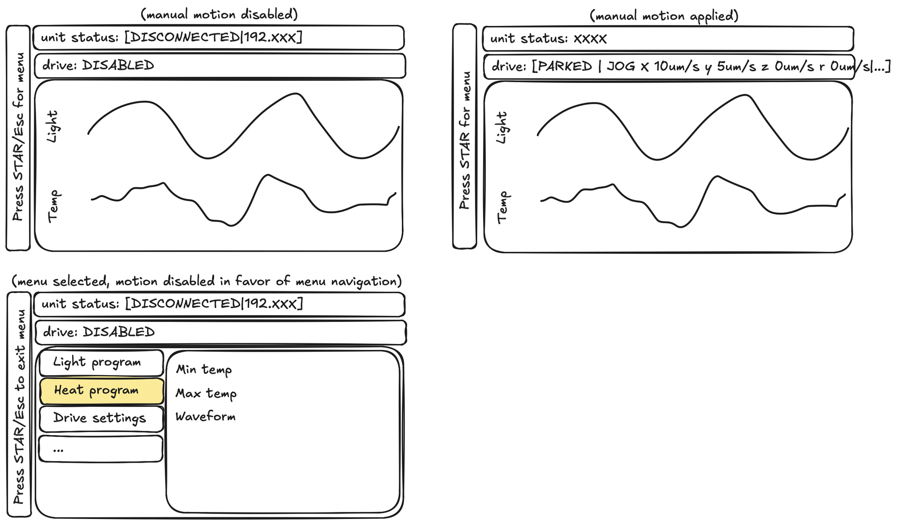
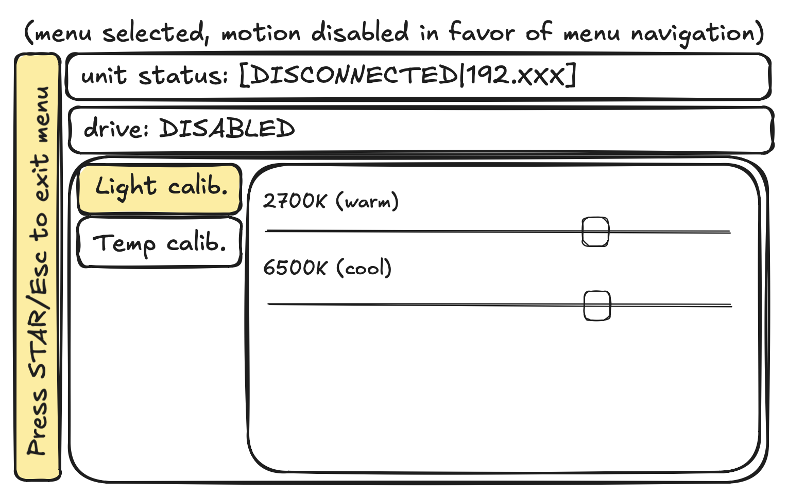

# mmi_app

The operator's window onto the mmi: the unit's status, the drive, and the incubator's light and temperature. It's
driven with the 8BitDo Ultimate 2C or a PS5 DualSense or, when neither is attached, the keyboard: PyQt6 and
pyqtgraph, on `mmi_client` (`../client/`).
- **Portable:** the same code and the same conda env (`mmi`) on a Mac, a PC or the Raspberry Pi. Only settings
  change: which screen, fullscreen or not, starting at login.
- **A view and an input mapping only:** everything about talking to the unit lives in `mmi_client`, which scripts
  (a ZEN-side hook, an MCP server) use too.

**Status (2026-10-30):**
- **Built:** the sketch's first two panels, live against the test server: the unit status, the drive, the plots.
- **The menu** (`ui_sketch_menu.png`): HOME (PS, Esc) opens it and halts any drive, and closes it from anywhere; B
  (Circle, Backspace) goes back a level. In it, **Light calib.** sets the two LED channels by hand: going in
  switches the lights to its sliders' levels, each move goes to the unit, coming out switches them off.
  **Temp calib.** drives the lid's Peltiers by hand, behind a switch that's off each time it's
  entered, and lists the lid's five temperatures (each readout's mean and SD, once a second); coming out, or the unit
  cutting the duty, turns the switch off.
- **Input profiles:** the 8BitDo or the DualSense whenever one's attached, else the keyboard. The hint and an icon
  in the top-right corner follow whichever is in use.
- **Limits:** an axis pushed where a limit switch (or a stall) blocks it reads LIMIT (STALL) in red, from the
  unit's own reports (api.md 6.5). The test server simulates the switches.
- **Tried:** the 8BitDo read on the Mac. SDL reports it as USB 2dc8:310a, with HOME as its `guide` button. The
  DualSense (054c:0ce6) is in the tests only so far: its first real run should show `DualSense (PS5)` on the right of
  the drive box.
- **Not tried yet:** driving with it by hand, the Pi, the real unit (section 6).





## 1. Run it

```sh
conda activate mmi
python -m mmi_client.test_server       # shell 1: a test server on 127.0.0.1:5000 (it prints what it's sent)
python -m mmi_app 127.0.0.1            # shell 2: the window, driving the unit at 127.0.0.1:5000
../start_application 127.0.0.1         # ... or the same through the launcher (../README.md)
```

What to expect:
1. **The app alone:** `unit status: DISCONNECTED | 127.0.0.1:5000`, `drive: DISABLED`.
2. **Start the test server** (the unit plugged in):
   - within a second, `CONNECTED | 127.0.0.1:5000 | fw test | motors on`, and `drive: PARKED`;
   - Temp shows the two medium probes, at the simulated room's 22 °C until the lid is driven; Light shows the unit's
     lights, dark until set (below).
3. **Drive** with the 8BitDo (or the DualSense), or the keyboard when no pad is in:
   - `drive: JOG x 250um/s y 0um/s z 0um/s r 0um/s` (the right stick full right), and the test server prints the jog;
   - let go: `PARKED`;
   - **into a limit:** the right trigger (Shift+D) runs the rail into its MAX switch 0.6 mm to the right. The test
     server prints `!limit r + pos=600`, and while it's pushed, `drive: JOG ... r LIMIT`, with LIMIT in red. The left
     trigger backs it off. Fine x's + switch is 0.6 mm to the right too, and z's bottom one 0.15 mm down;
   - halt (B, or Space on the keyboard): `HALTED` until everything is let go.
4. **The menu:** HOME (Esc on the keyboard). `drive: DISABLED | menu`, the hint `Press HOME to exit menu`, and the
   menu where the plots were. Any move under way halts first.
   - Up and down (the d-pad, either stick, the arrows) choose; right (or A, Enter) goes in.
   - **Light calib.:** going in sets the lights to its sliders (the test server prints `-> !light ...`). Up and down
     choose a slider, left and right move it: 0.1 % a press, 1 % pushed all the way (or with Shift), repeating while
     held. The bottom line is what the unit has in force.
   - **Temp calib.:** going in sends `lid duty=0`, with the switch at the top, `Peltiers OFF`. Down to the duty
     slider: left and right, 1 % a press, 5 % pushed all the way (or with Shift); left of the middle cools. Nothing
     goes yet. Up to the switch, A (Enter): `ON`, and the duty goes (the test server prints `<-  lid duty=20`), then
     each move. The page lists the board's three NTCs and the two medium probes, each with its SD under it, then the
     unit's two limits (60 °C on the board, `lid.medium_max` in the medium), and the bottom line what the lid is
     doing (`the lid: heating at 20 %`). At 50 % the simulated board warms ~3 K in the first 10 s and ~10 K in two
     minutes, settling near 53 °C within the hour (the lid model's), while the medium barely moves.
   - **Back:** B (Circle, Backspace) goes back a level: out of Light calib., the lights off; out of Temp calib., the
     switch off and the duty 0; again, from the list, out of the menu. Inside an item the hint says so: `B: back,
     HOME: exit menu`. In the menu B only goes back: it doesn't halt, nor if it's still held as the menu closes
     (nothing drives in the menu anyway). Space still halts there.
   - **Out:** HOME (PS, Esc; STAR on the 8BitDo too) closes the whole menu from wherever it is, leaving an item as
     going back would. Either way, nothing drives until the controls have been let go (`HELD`).
5. **Plug the pad in or out at any time.** The corner icon, the hint and the controls follow at once. A stick or a
   key held through the switch moves nothing until it's let go (`HELD`).
6. **Stop the test server:** `DISCONNECTED`. Start it again: the app reconnects by itself.

`python -m mmi_app` with no address drives the real unit at 192.168.50.2:5000. `python -m mmi_app --help` lists the
rest: `--config my.toml`, `--fullscreen`, and `-v`, which logs the input in use. The pad needs no flag: it's found
by itself.

On a Mac or Linux, `../start_application` does the network part first. It finds the wired Ethernet interface, waits
for its link, and gives it 192.168.50.1/24 for the session if it hasn't an address there already (a Mac's
`ipconfig set`, Linux's `ip addr add`: temporary, the saved settings left alone). Then it waits for the unit to
answer, says which gamepad the app will take, and starts the app, passing its arguments on (not a second one, if
it's open already).

**With Fusion alongside:** the test server mirrors its stage into `mmi` while Fusion has it open
(`../client/README.md`).
- **The units, end to end:**
  - the app sends µm/s (full deflection: 250 on the fine axes, 5000 on the rail);
  - the server's stage moves in µm;
  - the joints are set in mm, which Fusion holds as cm.
- **The window can be hidden:** on a Mac the app opts out of App Nap, so it keeps reading the pad with its window
  behind Fusion's.

## 2. The screen

To the right of a vertical hint bar there are three rounded boxes, and a small one in the top-right corner. The hint
reads `Press HOME for menu` with the 8BitDo, `Press PS for menu` with the DualSense, `Press Esc for menu` with the
keyboard.

| | Shows |
|---|---|
| unit status | `DISCONNECTED` or `CONNECTED`, the address, the firmware and MOTORS; a latched fault, in red |
| the corner | the input in use: Font Awesome's gamepad or keyboard |
| drive | what the drive is being told (below). On the right, the controls in use: `8BitDo Ultimate 2C`, `DualSense (PS5)`, `keyboard`, or `keyboard; other pad ignored` |
| main area | Light (warm and cool, %) over Temp (the two medium probes, J2 and J3, °C), on one time axis, over the last 10 min; or the menu, while it's open |

| Drive | When |
|---|---|
| `DISABLED` | no link, or MOTORS not on: no jog goes out |
| `PARKED` | ready, nothing asked for |
| `JOG x 10um/s y 5um/s z 0um/s r 0um/s` | the vector being sent, as sent |
| `JOG x LIMIT y 5um/s ...` | an axis pushed into a half-space a limit switch blocks: LIMIT in red for its speed. STALL likewise, after a stall. The rail's MIN switch, on the effector, blocks -x on fine x as well as on the rail, so both read LIMIT |
| `JOG ... y -20um/s? ...` | that axis's own switch is open at an end the unit can't tell (at power-up, say): it runs both ways, at no more than 20 µm/s, until the switch closes |
| `HALTED - let go to resume` | a halt holds (B, Space, or the unit's own) until every control is let go |
| `HELD - let go to resume` | a control still deflected after a reconnect, MOTORS coming on, leaving the menu, or a switch between pad and keyboard |
| `DISABLED \| menu` | the menu is open: the controls move it, and nothing drives |

- **Colours:** dark, for the microscope room. The lines take the unit LED's code: green ready, blue jogging, red
  halted or disconnected, grey disabled.
- **Where LIMIT comes from:** the unit says when a switch's state changes, and the whole state when the link opens
  (api.md 6.5). The client keeps a copy (`MmiClient.blocks()`), so nothing is asked per jog. Which end a fine axis
  hit, and that MIN blocks fine x too, the unit works out itself.
- **Size:** 800 x 480 by default, the HyperPixel's landscape size, so the Mac shows what the Pi will.
- **The menu** (`ui_sketch_menu.png`, `menu.py`, `nav.py`): its items on the left, the chosen one filled yellow; its
  page on the right. Inside an item the item keeps a yellow outline, and the chosen slider gets one too.
  - **Light calib.:** a slider per channel, 2700K (warm) and 6500K (cool): QSliders at 0.1 % a step (the unit sets
    the nearest of its own, 0.024 % apart), the level beside each, and the unit's lights as it reports them
    (`!light`), or its refusal in red.
  - **The lights follow the calibration:** in, its levels; out, whichever way (back, the menu closed, the app quit),
    off. The levels are kept for next time, and set again if the link drops and comes back while inside. If the app
    dies inside, the lights stay as they were: the unit holds them until told (api.md 9.1).
  - **Temp calib.** (api.md 9.2): the switch (`Peltiers OFF` / `ON`, orange while on), the duty slider under it
    (centred: the handle orange heating, blue cooling; ±`lid.duty_max`, 50 % unless the unit says otherwise), the
    lid's five temperatures as the unit reads them out, once a second (each its mean, with `sd 4 mK` under it; a
    board reading of 55 °C or more in red, the unit cutting at 60; a probe within 1 K of `lid.medium_max` in red), the
    two limits, and a line saying what the lid is doing: off, heating or cooling at what duty, held by SW10,
    unplugged, a bad sensor.
  - **The switch is the safety:** off each time the page is entered (and `lid duty=0` sent then), so no duty goes
    out until A (Enter) turns it on. It turns off, sending 0, on the way out (back, the menu closed, the app quit),
    and by itself, saying why in red, when the unit cuts the duty (a board NTC at 60 °C, a medium probe at
    `lid.medium_max`, a bad sensor, the lid unplugged), refuses it, holds another (set from elsewhere, or restarted),
    or the link drops. A duty is
    never sent again by itself: the unit drops it with the session that set it, and nothing resumes. The duty is
    kept for next time; the switch never is.
  - **SW10 off holds the drive off** with the switch still on: the line says so, and SW10 back on drives again.
  - **In the menu B (Circle) goes back and doesn't halt;** Space still halts on the keyboard. Neither touches the
    lid, but going back out of Temp calib. turns its switch off.
  - **Later:** the menu's other items (programs, drive settings).

## 3. Controls

| | 8BitDo Ultimate 2C | DualSense (PS5) | Keyboard, when no pad is attached |
|---|---|---|---|
| fine x, y | right stick | right stick | arrows |
| fine z | left stick, vertical | left stick, vertical | W / S |
| rail | triggers: left -x, right +x | L2 -x, R2 +x | A / D |
| speed | the deflection | the deflection | half a stick's deflection (~18 µm/s fine, ~270 µm/s rail); Shift for full |
| halt | B | Circle | Space |
| back (in the menu, instead of halting) | B | Circle | Backspace |
| menu | HOME (or STAR): open it (halting any drive); in it, out of the whole menu | PS, as HOME | Esc |
| in the menu | the d-pad or either stick to choose and set (fine part way, coarse all the way); A to go in, and to press a switch | the same, Cross for A | arrows (W / S too) to choose and set, Shift for coarse; Enter to go in, and to press a switch |

- **Input profiles** (`profiles.py`): one at a time, each driving through the same speed maps and halt rules.
  - **The pads are known by their USB ids,** the same on the Mac and the Pi, by USB or Bluetooth: the 8BitDo by
    2dc8:310a, the DualSense by 054c:0ce6 (the Edge 054c:0df2). No other pad can take over: one plugged in is ignored,
    and the drive box and the log (its name and ids) say so. With both attached, the first SDL lists drives.
  - **The DualSense's PS button** may also open Launchpad on a Mac; if it does, turn that off in System Settings >
    Game Controllers.
  - **With the pad attached, the keyboard does nothing,** not even halt. So the computer can be used meanwhile (a
    terminal on the Pi, say) without moving or halting the stage.
  - **A switch between the two** stops the jog, and nothing moves until the new one's controls are let go.
- **Each axis on its own:** an axis's speed comes from its own deflection only. Adding ↑ to a held → doesn't change
  x's speed, and a thumb's wobble inside the deadband doesn't drift the other axis.
- **No stuck keys:** the window losing focus lets go of every key.
- **HOME and STAR:** both sketches label the pad's menu button STAR; the app used HOME, as asked for on 2026-10-21.
  Since 2026-11-06 STAR is a menu button too, as SDL's `misc1`, which is not yet checked on the real pad. The hint
  still says HOME.
- **Full deflection is capped** at the unit's own `x.vmax`, `r.vmax` and so on, read on connecting.

## 4. Settings

`python -m mmi_app --config my.toml`: copy `config.example.toml`, which lists every key at its default.

| Section | Holds |
|---|---|
| `[unit]` | the address, and how often the records come (the lights' at `env_hz`, 2 Hz, for the plots; the lid's come by themselves, a readout a second) |
| `[gamepad]` | the poll rate, the deadman (the buttons are the profile's) |
| `[keyboard]` | a key's deflection, slow and fast |
| `[xy]`, `[z]`, `[r]` | the speed maps: deadband, `v_min`, `v_max` |
| `[view]` | rotation and mirror, so the tip follows the stick on screen |
| `[screen]` | size, fullscreen |
| `[plots]` | how much history the plots show |

## 5. How it's built

```
mmi_app/__main__.py     python -m mmi_app: the arguments, the QApplication, the window; Ctrl-C (or SIGTERM) quits
mmi_app/window.py       the hint bar, the corner icon, the two line boxes, the plots: widgets only
mmi_app/controller.py   the client, and the two timers that drive everything
mmi_app/hand.py         the hand controls to jogs, the halt button to halt (held until let go); nothing while the menu's open
mmi_app/menu.py         the menu: its items, Light calib.'s sliders and the lights they set, Temp calib.'s switch and duty
mmi_app/nav.py          the controls as a TV remote's moves: up, down, left, right, enter, repeating while held
mmi_app/profiles.py     the input profiles: the 8BitDo and the DualSense (their USB ids, halt and menu) and the keyboard
mmi_app/inputs.py       the profile in use as one controller state, its buttons as roles (halt, menu)
mmi_app/pad.py          the gamepad, through SDL (pygame): found by its USB ids, plugged in and out
mmi_app/shaping.py      deadbands and speed maps
mmi_app/texts.py        the two lines from the client's state, and Temp calib.'s texts (plain functions)
mmi_app/config.py       the settings
```

- **Threads:** Qt runs the main thread. The client's own threads (reader, jog sender, link) do all the I/O, and the
  app adds none.
- **The input timer, every 10 ms:** reads the profile in use, then `HandControl.step()`: halt first, then `jog()`.
  A jog on every tick keeps the client's deadman (0.25 s) fed, so a stuck window halts the unit.
- **The view timer, every 100 ms:** the two lines from the client's state, the hint and the icon from the profile, and
  new samples into the plots. The menu is redrawn by the input timer, as it moves.
- **The menu's lights and the lid's duty go through the client's mailbox** (`MmiClient.light()`, `lid_duty()`), so
  the window never waits on the unit. The input timer checks Temp calib.'s switch against the unit's lid on every
  pass (`Menu.sync()`), once the client says its duty's reply is in (`set_pending("lid")`).
- **Nothing crosses threads unsafely:** the client's callbacks (its reader thread) only append to a queue that the
  view timer empties. No widget is touched off the main thread, and nothing waits on a reply.
- **The env:** `../env.yml` builds `mmi` from conda-forge and installs both packages editable, from their
  `pyproject.toml`.
  - `mmi_app` asks for `mmi-client`, PyQt6, pyqtgraph, QtAwesome (the Font Awesome icons), numpy and pygame, plus
    appnope on a Mac.
  - `mmi_client` asks for nothing.

  ```sh
  conda env create -f env.yml      # from mmi/, the folder above; later: conda env update -f env.yml
  ```

## 6. Tests and next steps

**Tests:** `pytest`, from this folder, in the `mmi` env, offscreen (no window appears).
- the two lines for each state, LIMIT and STALL in red, the `?` cap, and the menu's;
- the menu without a window: the controls as moves (a press, held repeats, fine and coarse, what's held as it opens),
  Light calib. in and out, its sliders, its lights; Temp calib.'s switch before any duty, its cap, and the switch
  going off when the unit cuts (the medium's limit, with its value), refuses or changes the duty, or the link drops;
- Temp calib.'s texts: the temperatures (open, short, near either cut), the SDs, and the lid's line;
- the profiles: the 8BitDo and the DualSense by their USB ids and no other pad, the keyboard doing nothing while the
  pad is in;
- the hand controls (halt mid-push, the button held, the pad unplugged, a hung loop, a switch between devices);
- the speed maps, each axis on its own (the arrow keys too);
- the SDL reader, headless and inside Qt's event loop; one that takes no pad; the real 8BitDo or DualSense, if one's
  attached;
- the example config;
- **the units, end to end:** a stick held for a known time, then the jog in µm/s, the server's µm, the mirror's mm and
  Fusion's cm. Fusion is stood in for: the mirror's own scripts run against a stand-in for its API;
- **end to end:**
  - the window from DISCONNECTED to CONNECTED as a test server comes up;
  - keys driving it, and a key held past the lease;
  - the rail into its MAX switch: LIMIT in red while pushed, its speed again backing off;
  - the menu from the keyboard: opened mid-move (a halt), Light calib. in, fine and coarse steps, held to repeat, the
    test server's lights following and said back, Backspace back (off), in again (as before), Esc from inside out
    of the whole menu, driving again;
  - the menu from the 8BitDo: HOME, the d-pad, the stick, A, B back to the list (no halt), A in again, HOME from
    inside out of the whole menu with the stick held (`HELD`);
  - quitting from inside Light calib.: the lights off before the link closes;
  - Temp calib. from the keyboard: in (the switch off, the unit at 0), the five temperatures listed with their SDs
    and the limits, the duty set but
    not sent, the switch on (sent), a move (sent), SW10 off (held), the board at 61 °C (cut: the switch off, why in
    red), on again while hot (refused), on once cooled, Backspace back (0), in again (the duty kept, the switch
    off), Backspace twice out;
  - Temp calib. from the 8BitDo: A in, the stick and d-pad to a cooling duty, A on, B back (off, 0, no halt), in and
    on again, STAR from inside out of the whole menu (0);
  - quitting from inside Temp calib.: the duty 0 before the link closes; the unit ending the session: the switch
    off, and nothing resumes on reconnecting;
  - a halt held until let go, and Esc;
  - the 8BitDo plugged in (HOME, the gamepad icon, the keyboard ignored, B, HOME), then out with a key held;
  - the DualSense plugged in (its name, PS in the hint, the stick, Circle halting), then the menu: Cross in, PS from
    inside all the way out, Circle back to the list and Circle out again while held, never halting;
  - in the hand controls: B in the menu doesn't halt, nor held as the menu closes; Space there does;
  - the plots filling, and DISCONNECTED again when the server goes;
  - focus lost while a key is held.

`MMI_REVIEW_DIR=<folder> pytest tests/test_window.py` also saves screenshots of the states.

**Next, one step at a time:**
1. **The 8BitDo on the Mac,** with Fusion alongside: a feel for the speed maps (`[xy]`, `[z]`, `[r]`).
2. **Temp calib. on the real lid:** the heating sign (`lid.sign`), and the temperatures against a thermometer.
3. **The Pi with the test server:** the same env, the app fullscreen on the HyperPixel under the Pi's desktop,
   started at login.
4. **The Mac with the Teensy:** a USB-Ethernet adaptor at 192.168.50.1, and `python -m mmi_app`. Then the firmware
   README's bench steps, done from the app.
5. **The Pi with the Teensy:** the station by the microscope, joystick only.

**On the Pi, when we get there:**
- **The env:** Miniforge for aarch64, then `conda env create -f env.yml` in `mmi/`; everything has linux-aarch64 builds.
- **The link:** a static address on `eth0`, without a gateway, so the WiFi keeps the lab network:
  `sudo nmcli con add type ethernet ifname eth0 con-name mmi-stage ipv4.method manual ipv4.addresses
  192.168.50.1/24`, then `sudo nmcli con up mmi-stage`. `../start_application` then finds it there and asks for
  nothing.
- **The pad:** reading it needs the `input` group (the Pi's first user has it).
- **The display:** the Pi's HyperPixel touchscreen.
