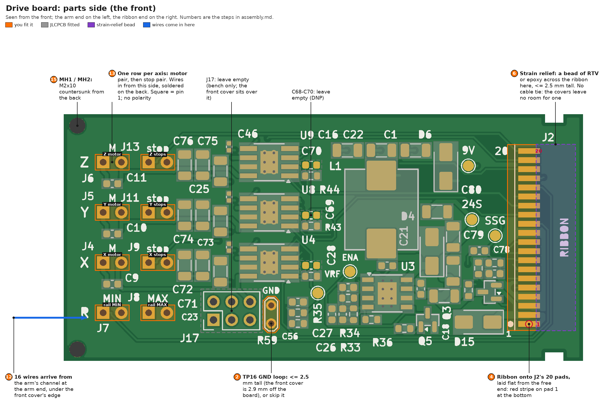
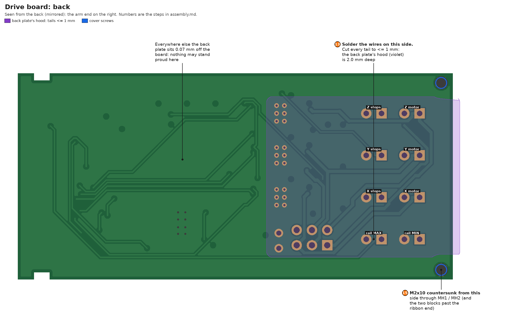
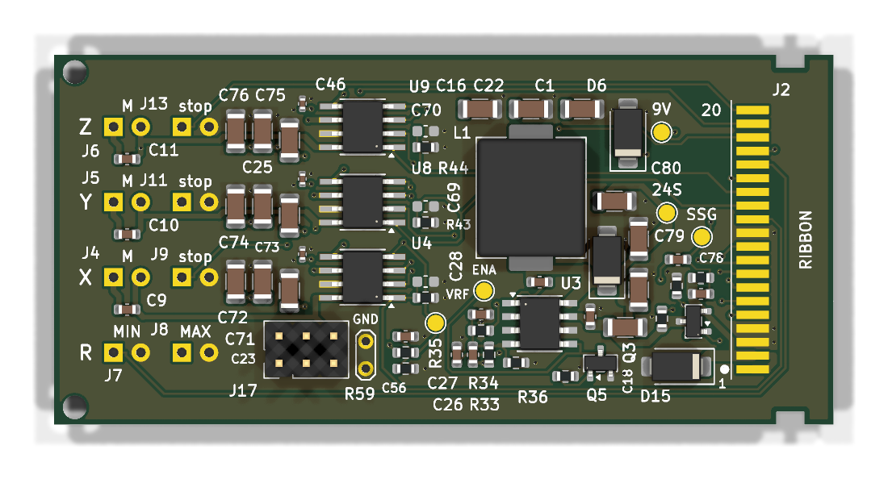

# Drive board: hand assembly and checks

The drive board rides on the rail's carriage with the XYZ head. It takes 24 V and the motor and switch lines from the
main board's J1 over a 20-way ribbon, makes its own 9 V (U3), and drives the three servo motors (U4, U8, U9,
DRV8251A). JLCPCB fit every SMT part ([`jlc/ORDER.md`](jlc/ORDER.md)). You fit the ribbon, the 16 motor and switch
wires and the covers, in this order, with a check (H0-H4) before each next stage.

- **The mechanical build** (frame, translators, switches, arm): the repo README, [Unit frame](../../../README.md#unit-frame).
  Step 10 lists what it must respect for this board.
- **The main board** must be built and tested first, its enclosure's tray on the frame:
  [`../main_pcb/assembly.md`](../main_pcb/assembly.md).
- **The firmware and the app** used in H4: [`../../../firmware/README.md`](../../../firmware/README.md),
  [`../../../firmware/api.md`](../../../firmware/api.md) (section 6), [`../../../app/README.md`](../../../app/README.md).

## The board

The front is the parts side, with the arm end on the left and the ribbon end on the right. Numbers are the steps
below:

The back, seen from the back, with the arm end on the right. The wires are soldered here, under the back plate's
hood:

As JLCPCB build it (KiCad's 3D view; J17 is drawn fitted, but stays empty):

**Frame:** X runs from the arm end (X 0, against `x_face`) to the ribbon end (X 72.4); Y up from the bottom edge
(0 to 34.4). In `drive.kicad_pcb`, x = 100 + X and y = 134.4 - Y.

### Probe map

**Test points** (1.5 mm pads, top side, labelled on the silkscreen):

| Label | Net | X, Y | Used in |
|---|---|---|---|
| `24S` | Q3's drain: the 24 V after the soft start, U3's input | 57.0, 19.7 | H0, H2 |
| `SSG` | Q3's gate | 60.2, 17.5 | H0, H2 |
| `9V` | U3's output: the motors' supply | 56.5, 27.2 | H0, H2, H4 |
| `VRF` | the drivers' current-limit reference | 35.5, 9.5: the lower-left of the two pads by U3 (its label sits between them) | H0, H2 |
| `ENA` | U3's enable, Q5's drain | 40.0, 12.5 | H0, H2 |
| `GND` (TP16) | GND: two holes for a wire loop | 29.0, 5.2 / 7.7 | everything |

The ribbon's own 24 V (before Q3) has no test point: probe ribbon pad 1 or 2.

| Part | Map |
|---|---|
| Ribbon pads J2 (X 63.4-66.4) | 1.27 mm pitch, pad 1 at the bottom (Y 5.1, marked "1") to pad 20 at the top. 1, 2: 24 V; 3, 4, 11: GND; 5/6: X IN1/IN2; 7/8: Y; 9/10: Z; 12-14: IPROPI X, Y, Z; 15: V9_OFF; 16: rail MIN; 17: rail MAX; 18: X stops; 19: Y stops; 20: Z stops |
| Wire holes, rows top to bottom (silkscreen Z, Y, X, R) | Z: J6 motor (X 5.5), J13 stops (X 11.85), at Y 27.7. Y: J5, J11 at Y 20.7. X: J4, J9 at Y 13.7. R: J7 rail MIN, J8 rail MAX at Y 6.7. Pin 1 (square) is the motor's A or the switch line; pin 2 of a stop pair is GND |
| J17 (holes only, X 20.9, Y 5.7) | pins 1/2 Z motor, 3/4 Y, 5/6 X (odd = A) |
| The ribbon's IDC socket (far end) | pin n = pad n; odd pins in one row, even in the other; the contacts take a probe tip |

## What you need

- **Iron:** temperature-controlled, with a fine conical tip (0.4-1 mm) for the 1.27 mm ribbon pads. Solder 0.5-0.7 mm,
  flux-cored; a no-clean flux pen; wick; isopropanol (99 %) and a brush.
- **Hand tools:** tweezers, flush cutters, flat pliers, a sharp craft knife, a stripper for 26-30 AWG, heat-shrink,
  a magnifier or loupe.
- **A multimeter** with continuity, diode test, a 200 Ω range, DC volts and mA; sharp probes; a clip lead for the black
  probe.
- **A current-limited bench supply,** 0-30 V, at least 1 A. A 47 Ω series resistor in place of one won't do for H2
  (the soft start's ~0.15 A inrush would drop 7 V in it): do H2's readings through the main board, at step 16, before
  the front cover goes on.
- **The ribbon test plug** (make once): a spare 2x10 box header (Würth 61202021621, as the main board's J1), pins 1+2
  joined to a red lead (24 V), pins 3+4 to a black lead (GND), ~20 cm each, for the bench supply; optionally pin 15 to
  a third lead (V9_OFF). Mark it "24 V / GND". Without it, two male DuPont pins in the IDC socket's pins 1 and 3 do.
- **ESD:** a wrist strap, or touch an earthed case before handling the board.

**Parts you fit:**

| Step | What | Part |
|---|---|---|
| 2 | TP16, the GND loop (optional) | tinned wire |
| 3-6 | the ribbon onto J2's 20 pads, and its strain relief | 3M M3AAA-2018J (20-way IDC, 457 mm, a socket at both ends); neutral-cure RTV (Bostik S41) or epoxy |
| 8 | each servo's motor pair | 3 x INJORA INJS11 (INJS11GD); 26 AWG silicone wire; heat-shrink |
| 9 | the three fine-axis switch chains and the rail's two switches | 8 x Omron D2F-01FL; 30 AWG wire (step 12); heat-shrink |
| 13 | the 16 wires into J4-J9, J11, J13 | - |
| 15 | the covers | `motor_enclosure_front_cover`, `motor_enclosure_back_plate` ([`../parts/`](../parts/)); 4 x M2x10 countersunk + 4 M2 nuts |

The arm the board sits in (`motor_board_arm`) goes on in the mechanical build. **Left empty:** J17 (bench only: the
front cover sits over it) and C68-C70 (not fitted: only if a motor's caps ever false-trip its current chopper).

## Rules for every step

1. **Inspect after soldering** (bridges, cold joints, lifted pads), and clean off flux with isopropanol before
   measuring: residue can read as tens of kΩ.
2. **Unpowered checks before every first power-up.** If one fails, stop and find out why.
3. **Powering up:** set the bench supply to 24.0 V and the step's current limit with its output off, then switch on
   (or SW9 ON) and watch the current. **Stop** if the current passes the step's stop value or the supply stays in
   current limit for more than about a second. **Never above 24.0 V:** D15 (SMAJ24A) starts conducting at 26.7 V.
4. **Probing a live board:** the black lead clipped to TP16 (or a stop pair's pin 2), only the red probe moving. Probe
   test points, holes and connector pins, never IC pins.
5. **Before soldering again:** power off and the ribbon unplugged.
6. **The JLCPCB-fitted ICs (U3, U4, U8, U9, PowerPAD) can't be reworked with an iron.** If a check points at one,
   stop, photograph it, check its neighbours and the schematic first, and don't heat it.
7. **Hot-plugging:** plug and unplug the ribbon only with the main board's SW9 or MOTORS (SW11) off. If it ever comes
   out live, wait at least 1 s before plugging it back: the soft start needs that long to reset.

**Conventions:** **R** = resistance, the red probe on the first point named. **D** = diode test, red (+) on the first
point; a silicon junction reads 0.5-0.75 V, a Schottky 0.15-0.35 V, OL is open. **V** = DC volts against TP16.
"Climbs": the reading rises while the meter charges a capacitor, which is normal; a short reads low and stays there.
"Pad n" is ribbon pad n. **GND** unpowered is any stop pair's pin 2 (the round hole of J7-J13), or TP16 once fitted.

## A. The bare board and the ribbon

### 1. H0: on arrival

**Snap the two rails off** within a few days of arrival (inspect within 7 days: JLCPCB's claim window): clamp the
board right up to each rail's score line and bend the rail, not the board. C1, C16 and C22 (22 µF 1206) lie along the
long edges, 4.1 mm in.

**Look:** D4, D6 and D15's cathode bands, Q3, Q5, and pin 1 of U3, U4, U8 and U9 against the silkscreen; C68-C70
empty.

**Measure (unpowered):**

| # | Mode | Red | Black | Expect | What it shows |
|---|---|---|---|---|---|
| 1 | R | pad 1 | pad 2 | 0 Ω | the 24 V pair |
| 2 | R | pad 1 | GND | ~250 kΩ, climbs | R78 + R79 (the soft start's gate divider), C77 charging: no short on the ribbon side |
| 3 | R | `24S` | GND | ≥ ~250 kΩ, climbs | no short on the buck's input (C18, C53, C79, C80, U3); through Q3's body diode the meter may see the divider too |
| 4 | R | `SSG` | GND | ~150 kΩ | R79 |
| 5 | R | `9V` | GND | 7.2-7.6 kΩ, climbs slowly (264 µF) | (R33 + R34) ∥ (R58 + R59) = 15k ∥ 14.7k = 7.42 kΩ: no 9 V short |
| 6 | R | `VRF` | GND | 3.85-4.05 kΩ | R59 ∥ (R58 + 15k) = 3.96 kΩ |
| 7 | R | pad 15 | GND | 100 kΩ | R36, the V9_OFF pull-down |
| 8 | R | pads 12, 13, 14 | GND | 2.0 kΩ each | R42-R44 (IPROPI) |
| 9 | R | pads 5-10 | GND | ~100 kΩ each (30-150 kΩ) | the DRV8251As' internal input pull-downs |
| 10 | D | `24S` | pad 1 | 0.5-0.75 V | Q3 the right way round (its body diode, drain to source) |
| 11 | D | pad 1 | `24S` | OL | (the same) |
| 12 | D | GND | pad 1 | 0.6-0.8 V | D15 the right way round (cathode on 24 V) |
| 13 | D | GND | `9V` | 0.15-0.35 V, after a climb | D4 (the buck's Schottky) the right way round, joined to `9V` through L1 |
| 14 | D | `9V` | GND | climbs to OL (or ≥ 1.5 V) | D6 the right way round: reversed, it reads 0.5-0.8 V |
| 15 | D | GND | J4-J6 pins 1, 2 (or J17's holes) | 0.4-0.7 V each | each driver's low-side body diodes: its OUT and GND joints |
| 16 | D | J4-J6 pins 1, 2 | `9V` | 0.4-0.7 V each | the high-side body diodes: the VM joints |
| 17 | R | J7, J8, J9, J11, J13 pin 1 | pads 16, 17, 18, 19, 20 | 0 Ω each | the switch map: MIN, MAX, X, Y, Z |
| 18 | R | J4, J5, J6 pins 1 / 2 | J17 pins 5 / 6, 3 / 4, 1 / 2 | 0 Ω | the motor map: X, Y, Z |

### 2. TP16, the GND loop (optional)

- A hoop of tinned wire through TP16's two holes (X 29.0, Y 5.2 / 7.7).
- **At most 2.5 mm tall:** the front cover sits 2.9 mm off the board.
- Without it, clip the meter's black lead to a stop pair's pin 2.

### 3. The ribbon's length, measured in place

The ribbon runs from J1 on the main board to J2's pads at this board's free end, with no twist and no fold. It leaves
J1 toward the front, makes a U-turn above the main board, runs back past the rail stepper, round the back of the unit
and along this board's face to its pads (as in the README's picture
[`18_main_board.png`](../assembly/18_main_board.png)). Its moving part is a horizontal U-loop standing on edge, like a
printer carriage's cable; the loop rolls by half the carriage's travel.

1. **Set up:** the main board seated in its tray; `x_face` with its servo and `motor_board_arm` on the rail's carriage
   (README, [Unit frame](../../../README.md#unit-frame)); this board dry-fitted in the arm's frame.
2. **Route the uncut cable:** one socket into J1, key to key (red stripe = pin 1). Lay the cable along the route to
   the pads with the carriage at mid-travel. The red stripe arrives at the bottom, on pad 1: a ribbon can't mirror
   without a twist.
3. **Check the loop:** run the carriage to both ends by turning the leadscrew. The loop must roll freely, pull at
   neither end, and stay clear of the condenser's footprint.
4. **Mark the cut** where the conductors' tips will lie: the pads' arm-end edge, X 63.4. Cut the far socket off
   there; expect ~250-300 mm. Keep the J1 end's socket: its triangle marks pin 1, on the red-stripe side.
5. Take the board out again: the ribbon is soldered on the bench.

### 4. The ribbon onto J2

1. **Prepare the end:** nick the insulation across the ribbon ~2.5 mm from the end with a sharp blade, without
   cutting strands; pull the end piece off with flat pliers. That leaves 20 bare ends at the pads' own 1.27 mm pitch.
   Twist each lightly and tin it with flux.
2. **Lay it flat on the pads from the free end:** the cable runs out past X 72.4, the conductors pointing toward the
   arm end, **the red stripe on pad 1, at the bottom edge** (ringed in `drive_front.png`), no twist.
3. Tack conductors 1 and 20 and check that every conductor sits on its pad.
4. Solder the rest one at a time, with flux and the fine tip.
5. Clean with isopropanol and inspect every gap under the magnifier.

### 5. H1: buzz the ribbon, before any switch is wired

At the IDC socket (R):

- **End to end:** socket pin n to pad n reads 0 Ω, all 20 (the switch and motor holes are easier to reach for 16-20).
- **Neighbours.** A solder bridge reads 0 Ω where this table says otherwise:

  | Pins | Expect | Pins | Expect |
  |---|---|---|---|
  | 1-2 | 0 Ω | 11-12 | 2.0 kΩ |
  | 2-3 | ~250 kΩ | 12-13, 13-14 | 4.0 kΩ |
  | 3-4 | 0 Ω | 14-15 | ~102 kΩ |
  | 4-5, 10-11 | ~100 kΩ | 15-16 | open |
  | 5-6 ... 9-10 | ~200 kΩ (two pull-downs) | 16-17 ... 19-20 | open |

- **Pins 11-14 matter most:** an IPROPI pad (12-14) bridged to GND (11) reads 0 Ω instead of 2.0 kΩ, and silently
  switches that axis's current regulation off.
- **Do it now:** once the switches are wired, pins 16-20 all read 0 Ω to GND through them, and a bridge between them
  can't be seen.

### 6. The strain relief

- **A bead of neutral-cure RTV** (Bostik S41; acetoxy RTV, the vinegar smell, corrodes copper) **or epoxy** across
  the ribbon's insulation, bonding it to the board just past the pads (X 66-71, violet in `drive_front.png`).
- **No cable tie:** the arm's frame and covers leave no room for one on either face.
- **No taller than 2.5 mm** (the front cover). Keep it off the edge strips where the frame's ledges sit (Y < 3.3 and
  Y > 32.25) and out of the two notches.
- RTV comes off again if the ribbon is ever replaced. Let it cure 24 h before handling the cable much.

### 7. H2: the board alone, powered

The ribbon test plug into the ribbon's socket; bench supply 24.0 V, limit 500 mA; black lead on TP16.

| Check | Expect | What it shows |
|---|---|---|
| the current at switch-on | a blip of ≤ ~0.35 A for a few ms, then 4-10 mA (stop above 30 mA) | the soft start, then U3 idling |
| the supply's current-limit light | stays off | no inrush past the soft start |
| `24S` | 23.9-24.0 V | Q3 is on |
| `SSG` | 14.1-14.6 V | Q3's gate at -9.6 V (24 V x 150k / 250k) |
| `9V` | 8.93-9.39 V (9.16 nominal) | U3, R33 / R34 |
| `VRF` | 2.83-3.03 V (2.93 nominal) | the drivers' current limit: 0.93 A (IPROPI 3.15 V/A on R42-R44) |
| `ENA` | a few volts (above 1.3 V), not 0 | U3 enabled; R36 holds Q5 off. The meter's 10 MΩ loads it a little |
| socket pins 12, 13, 14 | 0 V | IPROPI at rest |

- **Switch off and wait at least 1 s before switching on again.** The soft start needs it.
- **V9_OFF (optional; the firmware has no command for it yet):** 3.0-3.3 V (two AA cells, or a second channel) into
  socket pin 15 (+) and pin 3 (-). `9V` falls to 0 within ~1 s, `ENA` reads ~0 V and the current drops to a few mA;
  take it away and the 9 V comes back.
- **With a scope (optional):** `24S` rises 4-25 ms after the supply, over 2-6 ms; `9V` follows ~10 ms later.

## B. The wires

### 8. The servos' motor pairs (H3, at the bench)

For each INJS11:

1. Open it. Desolder the two motor leads from its control board, and take the board, its 3-wire cable and the
   positioning pot out. The motor and the gear train stay.
2. Solder a twisted pair of 26 AWG silicone to the motor's terminals, ~200 mm long (cut to length at step 12).
   Heat-shrink the joints.
3. Bring the pair out through the case's wire exit, where the old cable left, and close the case.
4. **Check (R):** the pair reads the winding, a few ohms: write it down (it is `<axis>.r_m` in the firmware's
   `parameters.yaml`) and expect all three within ~20 %. Turning the output by hand gives a few mV on the pair.

### 9. The switches

The switches sit in the printed faces as in the README's picture
[`7_limit_switches.png`](../assembly/7_limit_switches.png).

- **Every D2F-01FL is wired COM to NC.** Cut the middle (NO) pin to ≤ 0.8 mm: full length it reaches the face's M4
  screw.
- **Each fine axis:** its two switches sit end to end in its face, on the face's locating pins, glued. Join the two
  terminals that face each other (NC to NC, or COM to COM): either way the closed contacts are in series. The chain's
  two free ends get ~200 mm leads to that axis's stop pair. Heat-shrink every joint.
- **Rail MIN (J7): the operator's left (-x), the motor end.** The switch under `z_brace`, lever toward the motor end.
  It rides with the effector, so the firmware has it block fine -x too (`r.effector=min`). COM and NC get their own
  ~200 mm leads.
- **Rail MAX (J8): the operator's right (+x), the bearing end.** The switch on `x_face`'s overhang, lever toward the
  frame's bearing end. COM and NC get their own leads.
- **Wire the rail's two by position, not by any name in the 3D model** (its bodies are named from an older, mirrored
  frame). Swapped, the firmware latches `!fault r switches ... opened while moving away from it` at the first trip and
  freezes the rail until a restart.
- **Check (R) each chain or switch before it goes further:** ~0 Ω at rest, open while a lever is pressed. Open at rest
  means a lead is on NO.

### 10. The mechanical build

The README's [Unit frame](../../../README.md#unit-frame) steps: the rail and motor, the translators, the switches,
the braces and `x_face`. For this board, three things in its order matter:

- **The X servo goes into `x_face` before the arm:** the arm closes the servo pocket's end.
- **The arm goes onto `x_face` before `x_face` goes onto the X table:** the X and Z braces then block a straight driver
  to the arm's 2 x M2x20.
- **The Y servo, its nuts and tab screws go into `z_brace` before `z_brace` goes onto the stage.**

### 11. The board into the arm

- **From the back:** it rests on the frame's front ledges, MH1 / MH2 over the frame's holes.
- **The ribbon** leaves between the two blocks past the board's end.
- **Access:** the back faces the frame, 6 mm away. Work with the carriage run to the motor end, where the board hangs
  past the frame's end, or before `x_face` goes onto the carriage.

### 12. Route the wires, and cut them to length

The 16 wires all come in at the arm end, through the arm's channel (open to the front, 5.1 x 3.2 mm) and under the
front cover's edge (the blue arrow in `drive_front.png`), then fan out to their rows over the board's front, in the
2.9 mm under the cover.

- **Check the fit first:** 16 x 26 AWG silicone (Ø ~1.3-1.5 mm) is ~25-30 mm², against the channel's 16 mm². The ten
  switch wires carry under 1 mA, so 30 AWG (Ø ~0.5-0.9 mm) is plenty for them: motor pairs at 26 AWG plus switches at
  30 AWG come to ~11-15 mm².
- **Check the channel is open** where it steps up 4 mm into the frame; trim it if not.
- **Where the bundle stands proud of the channel,** keep it clear of the rail MIN switch under `z_brace`, which passes
  2.4 mm beside the arm.
- **Route with every stage at mid-travel:**

  | Group | Rides on | Slack |
  |---|---|---|
  | X motor, X stops, rail MAX | `x_face`, as this board does | none: route them tight |
  | Z motor, Z stops | `x_brace`: moves with fine X (±7 mm) | one ~20 mm loop |
  | Y motor, Y stops, rail MIN | `z_brace`: moves with fine X and Z | a ~20 mm loop each |

  Form each loop so it bends rather than slides, and keep it out of the stages' gaps.
- **Cut** each wire to reach its hole plus ~5 mm. Strip 2 mm and tin.

### 13. Solder the wires

- **The rows,** top to bottom (silkscreen Z, Y, X, R): the motor pair (M), then the stop pair.

  | Row | M | stop |
  |---|---|---|
  | Z (top) | J6: Z motor | J13: the Z chain |
  | Y | J5: Y motor | J11: the Y chain |
  | X | J4: X motor | J9: the X chain |
  | R (bottom) | J7: rail MIN, the `z_brace` switch (left, motor end) | J8: rail MAX, the `x_face` switch (right, bearing end) |

- **Polarity doesn't matter.** The square pad is pin 1, but the firmware sets each motor's direction, and a switch has
  none.
- **In from the front, soldered on the back.** Then **cut every tail to ≤ 1 mm**: the back plate's hood is 2.0 mm deep
  (violet in `drive_back.png`). Everywhere else the plate sits 0.07 mm off the board.

### 14. H3's checks, at the IDC socket

Before the covers (R):

- pins 16-20 each read ~0 Ω to pin 3;
- press each switch in turn and watch its pin go open: rail MIN 16, rail MAX 17, X (either switch) 18, Y 19, Z 20;
- J17's holes 1-2, 3-4 and 5-6 read the Z, Y and X windings, matching step 8's values.

## C. Close it, then connect

### 15. The covers

1. The front cover on the frame's front face. The wires pass under its edge at the arm end.
2. The back plate on the back, its hood over the wire joints.
3. **4 x M2x10 countersunk from the back:** through the plate, the board (MH1 / MH2) or the two blocks past the ribbon
   end, the frame and the front cover, into M2 nuts on the cover's face. The nuts have no pockets: hold each with
   pliers or a 4 mm spanner. Each nut fully engaged, ~1.5 mm of tip past it.

### 16. H4: on the main board

The main board in its tray with the firmware loaded; a computer at 192.168.50.1/24 on the cable to J19 (the README's
[Start the app](../../../README.md#start-the-app) sets that up). The commands below are typed into `nc 192.168.50.2 5000`; the USB serial
monitor takes the same, with the board lifted out of its tray. One TCP session at a time: the app and `nc` replace
each other.

1. **SW9 and MOTORS (SW11) OFF.** Plug the ribbon's socket into J1 through the enclosure's cut-out, key to key.
2. **Optional, while the Teensy is out (R):** the main board's TP3 `3V3` to TP4 `GND` reads ~400 Ω (its five 2k pull-ups, each to GND
   through a closed switch chain); press any one switch: ~500 Ω.
3. Teensy in; bench supply 24.0 V, limit 300 mA; SW9 ON. If the Teensy was already running on USB without this board, restart it
   first: MIN and MAX both open latches `!fault r switches` until a restart.

| Do | Expect | What it shows |
|---|---|---|
| SW9 ON, MOTORS off | the main board's own idle current (40-80 mA); D9 red at start-up, then green | nothing faulted |
| connect | `!hello ... motors=off`, then `!limit x 0`, `!limit y 0`, `!limit z 0`, `!limit r 0 pos=0`, and no `!fault` | the five chains closed, through the ribbon and J1 |
| press each switch, nothing moving | a fine axis's (either of its two): `!limit x ?` (y, z), back to `0` when let go. Rail MIN: `!limit r - pos=0` with `!limit x -`. Rail MAX: `!limit r + pos=0` | the switch map end to end; MIN and MAX not swapped |
| MOTORS ON | `!motors on` within ~0.2 s, D16 lit; the 24 V current up by ~5-20 mA (stop above 300 mA) | F4, the ribbon, the soft start, U3: the ribbon's 24 V comes through MOTORS |
| `watch drive 10`, then `jog x=200` | the X servo turns for one 250 ms lease, then `!halt on cause=lease`; the records show `x.i` 0.05-0.3 A while it turns, 0 after | U4, the X pair, IPROPI X down the ribbon |
| `jog`, then `jog x=-200` | `!halt off`, then the other way | |
| the same for `y` and `z` | only that axis moves, and only its `.i` reads | the motor and IPROPI map |
| `watch drive 0`, MOTORS OFF | `!motors off` | |

- Run each motor with its stage near mid-travel.
- **`9V` is under the front cover.** The motors turning shows it's there; to read it (8.93-9.39 V), do this step
  before fitting the cover.
- **Optional, the stall stop** (limit 500 mA): hold a servo's output firmly (a horn and a lever) and `jog x=250`.
  Within ~0.1 s `!stall x +` (or `-`) and the current falls back. `jog`, then a jog the other way lifts it:
  `!stall x 0`. The driver's own limit (0.93 A peak) sits above the firmware's stall stop (~0.70 A), so it isn't
  seen.
- **Optional, the soft start in place:** with SW9 and MOTORS ON, unplug the ribbon, wait ≥ 1 s, plug it in once. D8
  and the Teensy don't flicker. Unplugging latches `!fault r switches`: restart afterwards. Don't make a habit of it.
- **V9_OFF** has no firmware command yet (`acq`, later); H2's optional check tests it on this board.

### 17. The first jogs: watch the wires

- MOTORS ON, then the app (`../../../start_application`; controls in `../../../app/README.md`, section 3). Gently:
  half a stick is ~20 µm/s.
- Jog each fine axis end to end, slowly, watching its loops: nothing pulls tight or catches.
- Before any long rail move, check the rail's switches while driving (`../../../firmware/README.md`, "First power-up",
  step 5). Then run the rail end to end and watch the ribbon's loop.
- Set each fine axis's sign (`x.sign`, ..., the same section, step 4) and its `r_m` (step 8's readings):
  `../../../firmware/hardware.md`, "Commissioning".

## Pitfalls

1. **The ribbon's socket reversed at J1, or the ribbon twisted:** the ribbon's 24 V lands on the switch lines. The
   socket's triangle and the red stripe are pin 1; buzz the ribbon (H1) before it ever meets J1.
2. **A bridge on the ribbon pads (1.27 mm):** pads 2-3 (24 V to GND) only trip F4, but a bridge into a signal pad sends
   24 V down a logic line. H1's neighbour table finds them; do it before the switches go in.
3. **The ribbon re-plugged within a second of pulling it out live:** the soft start hasn't reset, and 3-45 A flows
   through J1. Wait ≥ 1 s.
4. **Switches wired to NO:** every input reads "hit" at rest and nothing moves. A chain must read ~0 Ω at rest.
5. **Rail MIN and MAX swapped:** `!fault r switches` at the first trip, the rail frozen until a restart.
6. **A servo's own board left on the motor:** it fights the driver. Step 8 takes it out.
7. **Tails over 1 mm on the back, a TP16 loop over 2.5 mm, or the strain relief over 2.5 mm:** the covers won't seat.
8. **A probe slipping across fine pitch on a live board:** use the test points, and clip GND.

## When a check fails

| Symptom | Look at |
|---|---|
| A `!limit` not `0` at rest with this board on | that switch chain open (a lead on NO, a broken wire) or in the wrong hole |
| A limit stays `0` with this board unplugged | a bridge to GND at J1, or on the main board's filter cap |
| `9V` absent, `24S` at 24 V | `ENA` at 0 (V9_OFF high? Q5 shorted?), U3, L1, D4 |
| `24S` absent, pad 1 at 24 V | Q3 (its gate: `SSG` should be ~14.4 V), R78 / R79 / C77 |
| A motor doesn't turn, its `.i` stays 0 | its pair in the holes, its PWM lines (the main board), the driver's VM (H0 check 16) |
| `!fault x sense` (IPROPI ~0 while driving hard) | that axis's IPROPI line: pads 12-14, R42-R44, the ribbon |
| The current reads but the motor stalls at once | the coupling jammed, or VREF low (`VRF`) |
