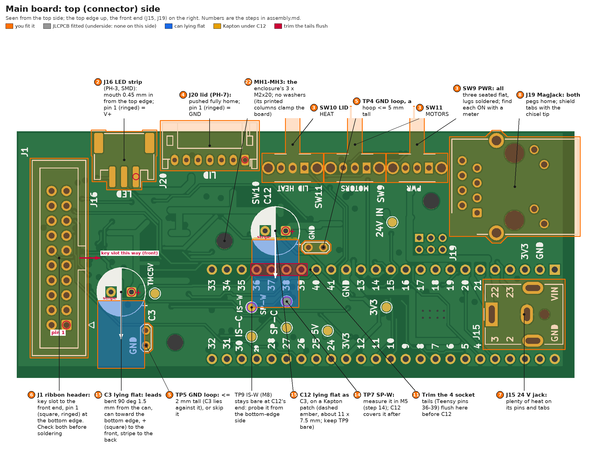
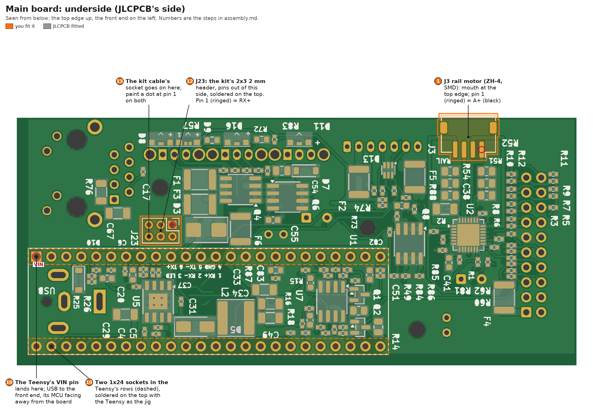
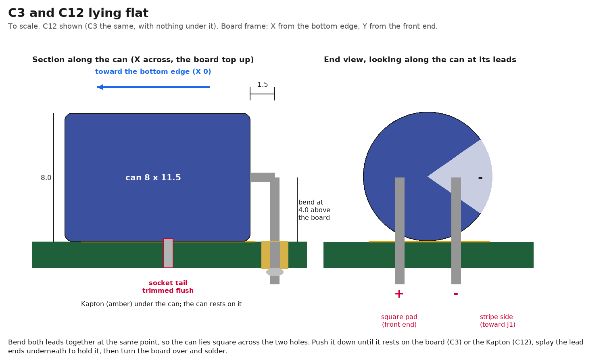
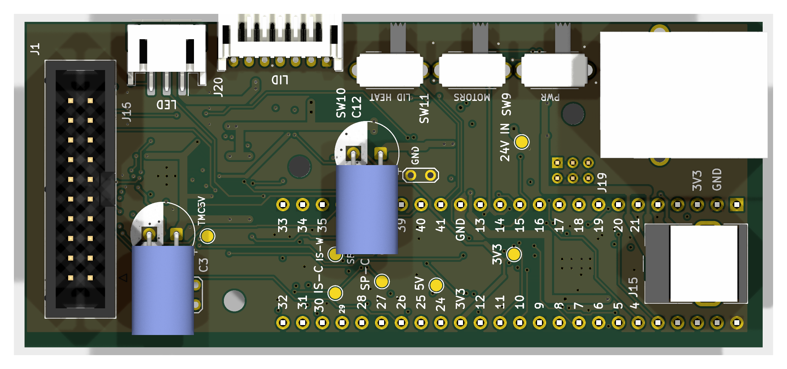
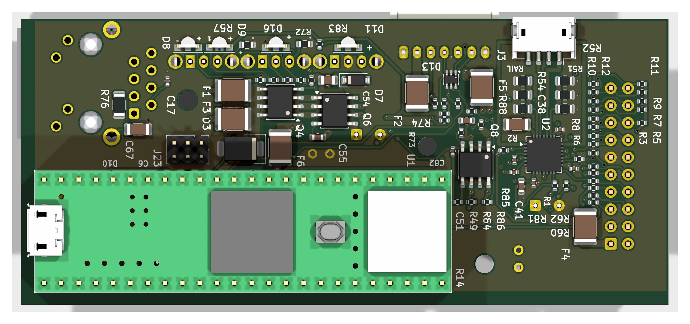

# Main board: hand assembly and tests

JLCPCB fit every SMT part, all on the board's underside ([`jlc/ORDER.md`](jlc/ORDER.md)). This guide covers the rest:
the hand-soldered parts in order, preparing the Teensy 4.1, the leads that plug into the board, the board's tests, and
closing it into its enclosure. The other boards: [drive board](../drive_pcb/assembly.md),
[heating board](../../lid/heating_pcb/assembly.md). The mechanical build: the repo's
[README, "Unit frame"](../../../README.md#unit-frame). Part numbers: [`bom.xlsx`](../../../bom.xlsx).

**The idea.** Every stage gets two kinds of check. **Unpowered:** resistances and diode drops, which find shorts,
missing or reversed parts (JLCPCB's underside included), bad joints you can't see, and wiring mistakes. **Powered:**
from a current-limited bench supply, so a fault limits instead of burning: rail voltages, the current drawn, and
what the firmware reports. Each check gives the value to expect and what it shows. Copy the tables, write the
readings beside them, and keep the sheet with the board.

**Before you start, know three things:**
1. **C12 and C3 lie flat,** so they go in after the Teensy's sockets. C12 lies over four socket tails and over TP7
   (SP-W). So M5 (USB only) runs before C12 goes in, and M1 (24 V) after it, with the Teensy out.
2. **The Teensy gets no Ethernet header:** the kit's cable is soldered into its Ethernet pads. The enclosure's tray is
   18.8 mm deep; the Teensy with the kit's header and plug needs 18.7.
3. **MOTORS (SW11) must be ON** for the TMC2209's check (M6), for M7 and for the drive board: it switches the
   TMC2209's supply and J1's 24 V.

## The board

Each hand-fitted part carries its step number. The top side, seen from above, top edge up, front end on the right:

The underside (JLCPCB's side), seen from below, top edge up, front end on the left:

**Frame** (all positions in this guide, in mm):
- X runs up from the bottom edge, the edge the board stands on; Y runs back from the front end (J15, J19). The
  outline extends 2 mm past X 0 and Y 0. In KiCad: x = 100 + X, y = 193 - Y.
- "Top" is the connector side. "Underside" is the SMT side, which the Teensy hangs from.
- Positions and pin functions: [Probe map](#probe-map).

## What you need

**Tools:**
- A temperature-controlled iron, 60 W or more: a fine conical tip (0.4-1 mm) for the SMD connectors, and a
  2.4-3.2 mm chisel tip for J15 and J19's shield tabs.
- Solder, 0.5-0.7 mm, flux-cored (63/37 or 60/40 is easiest; lead-free needs ~30 °C more); a no-clean flux pen or
  gel; desoldering wick; isopropanol (99 %) and a brush.
- Tweezers, flush cutters, a stripper for 26-28 AWG, heat-shrink, Kapton tape, a craft knife with a fresh blade, a
  paint pen.
- A magnifier or loupe (a phone camera on macro works).
- A PCB holder, or two blocks, so the underside's parts don't take the load while you solder the top.
- **A multimeter** with continuity beep, diode test, a 200 Ω range, DC volts and a mA range; sharp probe tips; one
  alligator-clip lead for the black probe, and two more clip leads (M7).
- **A current-limited bench supply,** 0-30 V, at least 1 A: every first power-up uses it. **Without one:** run the
  24 V supply through a 47 Ω, >= 10 W resistor in the + lead. A dead short then draws 0.5 A, and the board's
  10-80 mA loses only 0.5-4 V in it.
- **ESD:** a wrist strap, or at least touch the Mean Well's earthed case before handling a board.
- **A PC** with a USB port (micro-B cable for the Teensy) and an Ethernet port (or a USB adaptor).
- **Software:** the firmware's toolchain, Arduino IDE 2 with PJRC's Teensy core and QNEthernet
  ([`firmware/README.md`, "Building and flashing"](../../../firmware/README.md#building-and-flashing)), or
  [`write_firmware`](../../../write_firmware) on a Mac or Linux.
- **Optional:** an oscilloscope (the soft-start timings), a USB power meter, a USB isolator.

**Two test plugs, made once from this board's spare parts,** for the other boards' guides (each plugs in exactly as
into this board). Mark each "24 V / GND":

| Fixture | Made from | Wiring | Used by |
|---|---|---|---|
| Ribbon test plug | the spare 2x10 box header (Würth 61202021621) | pins 1+2 joined to a red lead (24 V), pins 3+4 to a black lead (GND), ~20 cm each; optionally pin 15 to a third lead (V9_OFF) | the drive board alone |
| Lid test plug | the spare JST S7B-PH-K header | pin 2 to a red lead (24 V), pins 1+7 joined to a black lead (GND) | the heating board alone |

## Parts you fit

| Step | Ref | Part | Side |
|---|---|---|---|
| 1 | J3 | JST S4B-ZR-SM4A-TF, ZH 4-pin, SMD (rail motor) | underside |
| 2 | J16 | JST S3B-PH-SM4-TB, PH 3-pin, SMD (LED strip) | top |
| 3 | SW9, SW11, SW10 | C&K SK-12D07-VG4-NS-PA, 4 mm handle (PWR, MOTORS, LID HEAT); the footprint's name says VG8 | top |
| 4 | J20 | JST S7B-PH-K-S, PH 7-pin (lid) | top |
| 5 | TP4, TP5 | tinned wire, ~0.6 mm (a resistor's cut lead will do) | top |
| 6 | J1 | Würth 61202021621, 2x10 box header (ribbon) | top |
| 7 | J15 | CUI PJ-063AH (24 V in) | top |
| 8 | J19 | the MagJack from the PJRC Ethernet kit | top |
| 9 | - | Teensy 4.1 (DEV-16996 with headers, or DEV-16771 without: then two 1x24 male strips); 1N5819HW (or any SOD-123 Schottky of >= 0.5 A, e.g. B5819W) | - |
| 10 | U1 | two 1x24 female sockets, 8.4-8.5 mm, each cut from a square-pin 1x40 strip (not the round-pin ones) | underside |
| 12 | J23 | one of the Ethernet kit's two 2x3 2 mm headers | underside |
| 13 | - | the Ethernet kit's 6-wire cable | - |
| 15 | C12, C3 | Panasonic EEU-FR1H101, 100 µF 50 V, 8 x 11.5 mm, lying flat; Kapton under C12 | top |
| 18 | - | rail motor plug: JST ZHR-4 + two ASZHSZH28K305 leads, cut in half | - |
| 19 | - | LED strip plug: JST PHR-3 + two ASPHSPH24K305 leads, cut in half (three halves used) | - |
| 20-22 | - | the enclosure, printed: `main_enclosure_tray`, `main_enclosure_cover`, 3 x `main_enclosure_cap` ([`../parts/`](../parts)); 3 x M2x20 socket head + 3 M2 nuts; 3 x M3x8 countersunk + 3 M3 nuts | - |

Not used: the Ethernet kit's adaptor board and its 0.1 µF (C17 is SMD, fitted by JLCPCB), the kit's second 2x3
header, and washers at MH1-MH3 (the enclosure's printed columns clamp the board; no metal touches it there).

## Rules for every step

1. **Inspect after soldering:** bridges, cold or dull joints, lifted pads. Clean off flux with isopropanol before
   measuring: residue reads as tens of kΩ.
2. **Unpowered checks before every first power-up.** If one fails, stop and find out why before going on.
3. **Powering up:** set the bench supply to 24.0 V with the step's current limit, and switch its output on with SW9
   OFF. Then SW9 ON, watching the current. **Stop** (output off) if it passes the step's stop value, or the supply
   stays in current limit for more than about a second. A brief flash while the 24 V rail ramps (~25 ms) is normal.
4. **Probing a live board:** clip the black lead to a GND loop (TP4 or TP5) and move only the red probe. Probe test
   points, connector pins and through-hole joints, never IC pins: a slipping probe on fine pitch can short 24 V into
   logic. Keep one hand off the board.
5. **Before soldering again:** SW9 OFF, supply disconnected, and C12's + lead under 1 V.
6. **JLCPCB's ICs (QFN, PowerPAD) can't be reworked with an iron.** If a check points at one, stop and photograph it,
   check its neighbours and the netlist before blaming the part, and don't heat it.
7. **Hot-plugging:** the rail motor (J3) never: it can destroy the TMC2209. The ribbon (J1) only with SW9 OFF; if it
   comes out live, wait at least 1 s before plugging it back. The lid (J20) may be plugged live, best with SW10 OFF.

## On arrival

**Look** (against JLCPCB's placement preview): every underside part present; the polarity marks of D3, D5, D7, D10,
D13, D8, D9, D11, D16 and pin 1 of U2, U5, U7 on their silkscreen marks; no solder balls or bridges. U2 (the TMC2209,
a QFN) can't be inspected: M0 checks 20-21 test its joints.

**Measure:** [M0](#m0-unpowered-the-teensy-out) on the bare board, at the holes and pads of the parts not yet fitted.
GND is C12's - hole (23.0, 50.7) until TP4 is in; C12 + and C3 + are their + holes. Skip checks 11, 16 and 31, which
need the switches; do these instead:

| Mode | Red | Black | Expect | What it shows |
|---|---|---|---|---|
| R | SW9 hole 1 | SW9 hole 2 | ~1 MΩ, climbs | R56 (C54 across it) |
| D | SW9 hole 2 | SW9 hole 1 | 0.6-0.8 V | D7, the gate zener, the right way round |
| R | SW11 hole 2 | C12 + | ~100 kΩ, climbs | R82 (C81 across it): Q8's gate to source |

**T1**, the Teensy's stock test (out of the box, on USB, its orange LED blinks), can be done any time before step 9.

## A. The SMD connectors

### 1. J3, the rail motor connector (underside)

- **Where:** the underside, at the top edge, its mouth past the edge, directly under J16's place. Fit it first,
  while the top side is still flat.
- **Technique (J3 and J16):**
  1. Tin one mounting-tab pad.
  2. Hold the connector with tweezers and reflow that tab.
  3. Check that every pin sits centred on its pad and the mouth is square to the edge.
  4. Solder the other tab.
  5. Solder the pins one at a time, with flux and the fine tip.
  6. Inspect between the pins.
- **Pin 1 (A+)** is the pin nearest the back (Y 77.0), ringed in the underside picture.

### 2. J16, the LED strip connector (top)

- The same technique. Its mouth sits 0.45 mm inside the top edge; its solder tabs are at its very front.
- **Pin 1 (V+, 24 V through F5)** is the pin nearest the front (Y 72.7).
- **Check (M2, R):** no 0 Ω between neighbouring pins: J3 1-2, 2-3, 3-4; J16 1-2, 2-3. **J16 1-2 matters most:** a
  bridge there puts 24 V across Q1 at the first set-point. Then repeat M0 checks 20-23 at the fitted pins.

## B. The top side, through-hole, low to tall

Each part goes in from the top and is soldered on the underside. Support the board on blocks, clear of the SMT parts.

### 3. SW9 (PWR), SW11 (MOTORS), SW10 (LID HEAT)

- **Order, front to back:** SW9, SW11, SW10. The silkscreen reads PWR, MOTORS, LID HEAT.
- **Seat each flat,** its handle out over the top edge. The 4 mm handle ends about flush with the edge; the printed
  caps extend it (step 22).
- **Solder** the three pins and both lugs. The lugs take the push.
- **Find each ON position (R, unpowered).** On all three, ON joins hole 2 (the middle) to hole 3 (the back one); OFF
  joins hole 2 to hole 1. Find which slider position does that, and mark it on the board's edge beside each switch.

### 4. J20, the lid connector

- The PH 7-pin side-entry header: push it fully home on its pegs, its mouth at the top edge.
- **Pin 1 (GND)** is nearest the front (Y 54.1).

### 5. TP4 and TP5, the GND loops

A hoop of tinned wire through each pair of holes, soldered underneath. Fit both now: the caps make them awkward
later.
- **TP4** (X 20.2, Y 40.8 / 43.3): up to ~5 mm tall. It stands 1.3 mm in front of C12's can.
- **TP5** (X 3.5 / 6.0, Y 71.0): **at most 2 mm tall, or leave it out.** C3's can lies right behind it, its flank
  within 0.2 mm of the holes' line 3-5 mm up. TP4 is enough for the meter's clip.

### 6. J1, the ribbon header

- **The key slot faces the front end** (J15, J19). The key is the gap in the middle of the shroud's long side.
- **Pin 1 (square pad, the header's triangle) is at the bottom edge** (X 7.0).
- **Check both before soldering.** Turned round, J1 puts the ribbon's 24 V onto the limit-switch lines.
- Tack two corner pins, check the header sits flat, then solder all 20.

### 7. J15, the 24 V jack

- Seated flat, its mouth at the front end.
- Use the chisel tip and plenty of heat on its two pins and two tabs.

### 8. J19, the MagJack

1. Press it in until both plastic pegs are home.
2. Solder the signal pins.
3. Then the two shield tabs, with the chisel tip and patience.

**Check after B (M3, R, unpowered; GND = TP4):**

| Between | Expect | What it shows |
|---|---|---|
| J1 pin 1 and pin 3; pin 2 and pin 4 | > 100 kΩ | no bridge from the ribbon's 24 V to GND |
| J20 pins 1-2, 2-3 | > 100 kΩ, not 0 | no bridge from the lid's 24 V to GND or SDA |
| M0 checks 36-42, at J1's and J20's pins | as M0 | the header joints (the Teensy's end at its socket holes) |
| J23 holes 5-6, and 1-2 | 0.3-2 Ω | the MagJack's TX and RX windings, soldered |
| J23 hole 4; J19 pins 8 and 9 | 0 Ω to GND | the grounds |
| J19 shield tab | ~1 MΩ to GND | R76 |
| SW9 pin 1 to pin 2, SW11 pin 1 to pin 2, both OFF | 0 Ω | the OFF marks (M0 checks 11, 16) |
| SW10 pin 1 to GND, SW10 OFF / ON | 0 Ω / open | SW10's throws and its ON mark (M0 check 31) |

## C. The Teensy and its sockets

### 9. Prepare the Teensy (off the board)

1. **T1:** the stock test, if not done yet.
2. **T2: cut the VUSB-VIN trace.** On the side without the MCU, beside the USB socket, two pads marked VUSB and VIN
   are joined by a thin trace. Cut it with a fresh blade, several light strokes, then brush away the debris.
   **Check (R, USB unplugged):** VUSB to VIN open both ways.
3. **T3: the 1N5819HW across the cut.** **Anode (no band) on VUSB, cathode (band) on VIN.** Tin one pad, place it,
   solder, then the other. **Check (D):** red on VUSB, black on VIN, 0.15-0.35 V; reversed, OL. Nothing bridged to
   the parts beside it.
4. **T4:** on USB again, VIN reads 4.4-4.9 V and 3.3V reads 3.25-3.35 V (to GND).
- **Headers:** a DEV-16996 ("with headers") has them, the plastic on the side without the MCU: right for this board.
  A DEV-16771 has none: its two 1x24 male strips go in at step 10, with the sockets as the jig.
- **No Ethernet header** on the Teensy: the cable is soldered straight into its pads at step 13.

### 10. The sockets (underside), with the Teensy as the jig (M4)

1. Push the two 1x24 female sockets into the U1 holes from the underside (the dashed rows in the underside picture).
   Don't solder them yet.
2. Plug the Teensy into them:
   - **DEV-16996:** its own pins go straight into the sockets.
   - **DEV-16771:** push the male strips' long ends into the sockets and set the Teensy on their short ends. Then
     solder its 48 header pins on its MCU side.
3. **Orientation:** the Teensy's MCU faces away from the board; its USB is at the front end; its VIN pin lands in the
   hole at X 16.4, Y 1.3 (ringed in the underside picture). Turned round, 5 V lands on the Teensy's GND pin.
4. Support the stack on blocks, top side up. Solder the 48 socket pins on the top.
5. Rock the Teensy out, end to end.
- **Check (R, Teensy out):** no two neighbouring socket joints read 0 Ω. These matter most: VIN-GND (X 16.4,
  Y 1.3 / 3.9), GND-3V3 (X 16.4, Y 3.9 / 6.4), pin 12-3V3 (X 1.2, Y 34.3 / 36.9).

### 11. Trim the four socket tails under C12

- **Which:** the tails of Teensy pins 36, 37, 38 and 39 (the X 16.4 row, Y 44.5-52.1; red in the top-side picture).
- **Why:** they stand ~1.4 mm proud and would hold C12's can about 1 mm off the board.
- **How:** cut them flush with their joints using the flush cutters. Check each joint is still a whole fillet, and
  pick up the clippings.

### 12. J23, the Ethernet header (underside)

- One of the kit's 2x3 2 mm headers: plastic and pins on the underside, soldered on the top.
- **Pin 1 (RX+) is at X 21.8, Y 24.4** (ringed in the underside picture). Put a paint-pen dot beside it. The
  underside silkscreen reads 1 RX+, 2 RX-, 3 LED, 4 GND, 5 TX-, 6 TX+.
- **Check:** M0 check 45 at its pins.

### 13. The kit cable onto the Teensy

The kit's 6-wire cable has a 2x3 socket at each end. One socket stays and plugs onto J23; the other end is soldered
into the Teensy's six Ethernet pads.

1. **Length:** Teensy in its sockets; the kept socket on J23, with a paint dot on the socket too, dot to dot. Lay the
   cable to the Teensy's Ethernet pads (the 2x3 of pads in its middle) through the 11 mm gap between the Teensy and
   the board. Add ~10 mm and cut off the other socket there.
2. Split the six conductors back ~8 mm, strip ~1.5 mm, twist and tin each.
3. **Which conductor goes where: by signal, not by position.** With the socket on J23 (dot to dot), buzz each
   conductor to J23's joints on the top side, and solder it into the Teensy pad of the same signal. The Teensy's
   labels are on its side without the MCU, and read R- R+ / G LED / T+ T- from that side.

   | J23 pin | Signal | Teensy pad |
   |---|---|---|
   | 1 | RX+ | R+ |
   | 2 | RX- | R- |
   | 3 | LED | LED |
   | 4 | GND | G |
   | 5 | TX- | T- |
   | 6 | TX+ | T+ |
4. **Solder** with the Teensy out and the cable unplugged from J23: insert each conductor from the side without the
   MCU, so the cable stays in the gap; solder on the MCU side and trim flush.
- **Check (Teensy out, the socket on J23 dot to dot, R):** the Teensy's G pad to TP4, 0 Ω; its LED pad to J19
  pin 10, 0 Ω. With the Teensy out its GND reaches the board only through the cable, so these two prove the
  orientation.
- **From now on:** the socket goes onto J23 dot to dot. Unplug it before pulling the Teensy.

### 14. M5: the Teensy in, USB only

- Flash the Teensy first ([T](#t-the-teensy-off-the-board-check-and-flash)), then run
  [M5](#m5-the-teensy-in-usb-only).
- In M5, also `light warm=50` and read **SP-W at TP7** (0.99 V): after step 15, C12 covers TP7. SP-C (TP8) stays
  reachable.

## D. The capacitors, then 24 V

### 15. C12 and C3, lying flat

The blue outlines in the top-side picture show where each can lies.

- **Both the same way:** **+** (the longer lead, no stripe) into the square pad, on the front-end side; the can lies
  toward the bottom edge, square across the line of its two holes; the stripe (-) faces the back end (J1).
- **Bend:** hold both leads together and bend them 90° at the same point, 1.5 mm from the can's end (the rubber
  seal). They then run out of the can along its axis and turn down 4.0 mm above the board: half the can's 8 mm.
- **C12 (Teensy out):**
  1. Cut a piece of Kapton about 11 x 7.5 mm. Stick it where C12's can will lie: X 11.0-21.8, Y 45.3-52.8, over the
     trimmed tails and TP7 (amber in the top-side picture).
  2. Keep TP9 (IS-W) bare at the can's end: M8 probes it from the bottom-edge side.
  3. Insert the leads and press the can flat onto the Kapton.
  4. Splay the lead ends on the underside to hold it, then turn the board over and solder. Trim the leads.
- **C3:** the same, straight onto the board; nothing lies under it. TP5's loop (2 mm at most) is just in front of it.
- **They must lie flat:** the enclosure's cover has only shallow pockets over them. The can tops are 8.0 mm above the
  board, 8.5 at the top of Panasonic's tolerance.
- **Check (R):** C12's + lead to GND reads > 100 kΩ, climbing (M0 check 2).

### 16. M1: the power path, the Teensy out

Teensy out (unplug the cable from J23 first). [M0](#m0-unpowered-the-teensy-out), then
[M1](#m1-24-v-the-teensy-out).

### 17. M6: the Teensy on 24 V

Teensy in, the cable on J23 dot to dot. [M6](#m6-the-teensy-on-24-v).

## E. What plugs into the main board

### 18. The rail motor's plug (J3), then M7

The rail's NEMA11 lead ends in bare wires. The plug is a ZHR-4 with two pre-crimped ASZHSZH28K305 leads cut in half:
four ~150 mm wires, each crimped at one end.

1. **Coils first (R, at the bare ends):** black-green is one coil, red-blue the other, ~4.4 Ω each and within ~10 %
   of each other; black to red reads open. The wires leave the motor interleaved (green, blue, black, red), so go by
   colour, not by order.
2. **Length:** route the motor's lead along the rail and through the frame's wire channel to the tray's J3 notch. Cut
   it ~60 mm short of J3, so the four joints sit outside the enclosure. If the lead is short of that, use four whole
   ZH leads instead of halves.
3. **The ZH halves are all black:** tag each with its pin number before soldering.

   | ZHR-4 pin | Motor wire | Coil |
   |---|---|---|
   | 1 | black | A+ |
   | 2 | green | A- |
   | 3 | red | B+ |
   | 4 | blue | B- |
4. Solder and heat-shrink each joint, staggered ~10 mm apart so the bundle stays slim.
5. Push each crimp into its ZHR-4 position until it clicks, and tug it.
   - **Find pin 1 on the housing at J3, not by its moulding:** with the board unpowered, push the empty housing into
     J3 (it only goes one way). The cavity at the back end (toward J1, Y 77.0) is pin 1. Mark that end with a paint
     dot, then load it, back to front: black, green, red, blue.
   - Swapping the two wires of one coil (black with green, or red with blue) only turns the motor the other way.
     Never put one coil's wires on 2 and 3.
6. **Check (R, at the housing's contacts):** pins 1-2 and 3-4 each read a coil; pins 1-3 read open.
7. **Plug it in only with SW9 OFF, and never pull it live.**
8. [M7](#m7-the-rail-motor-j3).
- The mated plug ends just under the microscope condenser's clearance plane: turn the leads along the board's edge
  right at the housing.

### 19. The LED strip's lead (J16), then M8

- **The strip:** the 24 V COB CCT strip, cut only at its 50 mm marks into the two pieces for the chamber's long
  walls, joined end to end with three short 26 AWG links: V+ to V+, W- to W-, C- to C-.
- **The lead:** three 26 AWG silicone wires from the first piece's pads, long enough to reach J16 along your route.
  Twist them together, and keep them away from the motor wiring.
- **The plug:** a PHR-3 with three halves of the ASPHSPH24K305 leads (~150 mm each; one half spare). Tag them before
  soldering (they are one colour); joints staggered and heat-shrunk. Pin 1 V+, pin 2 W- (warm), pin 3 C- (cool).
- **Check (R):** each pin to its strip pad 0 Ω, and no pin to its neighbour.
- [M8](#m8-the-led-strip-j16), with the strip at its final length.
- Like J3's plug, J16's leads turn along the edge right at the housing.

## F. Into the enclosure

The pictures of these steps (frame/17, frame/18) are in the [README, "Unit frame"](../../../README.md#unit-frame).

### 20. The enclosure's tray onto the frame

- Drop the three M3 nuts into the hex pockets in the tray's three floor bosses.
- Bolt the empty tray to the frame's three end pads: 3 x M3x8 countersunk from the frame side into the nuts.
  **Not longer than M3x8:** under the Teensy, an M3x8's tip is 0.55 mm short of its PCB. The back-bottom screw needs
  an L-key, short arm in.

### 21. The drive board and the lid

- **Drive board:** [`../drive_pcb/assembly.md`](../drive_pcb/assembly.md). It measures the ribbon with this board
  seated in the tray, and ends with its test on this board.
- **Lid:** [`../../lid/heating_pcb/assembly.md`](../../lid/heating_pcb/assembly.md), ending with its test on this
  board.
- **USB:** the tray closes the Teensy's USB in. For checks over USB, lift the board out of the tray beside it (the
  ribbon and leads stay plugged), then seat it again; or run them over Ethernet (`nc 192.168.50.2 5000`, M6) with the
  board seated.

### 22. Close up

1. **Before the board goes in for good:** load the firmware, and put the microSD card (FAT32; the BOM's KEXIN 16 GB)
   in the Teensy's slot with [`parameters.yaml`](../../../firmware/sd/parameters.yaml) at its root (`write_firmware`
   offers to copy it). Both the USB socket and the card face the tray's floor once the board is in.
2. Board into the tray, Teensy down, MH1-MH3 over the tray's columns.
3. **Cover on:** J1's shroud into its cut-out, flush with the face; the RJ45 and J15 into their bumps.
4. **3 x M2x20 socket heads** from the cover's face down its counterbores, through MH1-MH3 and the tray's columns,
   into M2 nuts in the hex pockets in the tray's back face. Hold each nut there (a finger or tape) until its screw
   catches, then snug.
5. **The switch caps:** press a `main_enclosure_cap` onto each switch's handle through the cover's slots. They're a
   press fit; keep each with its switch.
6. **Plug in:** J20, J16 and J3 through their notches (J3 only with SW9 OFF); the ribbon into J1; the Ethernet cable
   into J19; the 24 V plug into J15.
7. [S1](#s1-everything-plugged-in-on-the-bench-supply) (everything on the bench supply), then the Mean Well
   ([The 24 V supply](#the-24-v-supply-j15)) and [S2](#s2-change-to-the-mean-well), then
   [S3](#s3-commissioning-and-records).

## The 24 V supply (J15)

**The Mean Well LRS-350-24 is a mains supply with screw terminals: its AC terminals are live.**

- **Mains side:** wire it from an earthed, fused 3-core lead (the BOM's GlobTek 6104136F000: brown to L, blue to N,
  green/yellow to the earth terminal, FG). Keep the terminal cover on and add strain relief. If you're not confident
  wiring mains, have someone qualified do it.
- **Input-voltage selector:** if your unit has one, set it to your mains (230 V in the UK) before it ever sees
  mains. On 115 V at 230 V mains it is destroyed.
- **Earth:** link -V to FG. It's the unit's only earth.
- **Set the output with no load:** power it with nothing connected and set V ADJ for **24.0 V** at its output
  terminals. **Never above:** the 24 V TVS diodes (D3 here, and the drive and heating boards' own) start conducting
  at 26.7 V, and the trimmer reaches 28.8 V. **Lock the trimmer** with a dab of nail varnish or glue.
- **DC lead:** 2 m of the Haerkn 22 AWG 2-core to a CUI PP3-002AH plug (5.5 x 2.1 mm, 14 mm barrel), centre
  positive.
  - **Slide the plug's screw-on cover onto the cable first.** Solder + to the centre pin's eyelet, - to the sleeve's.
  - Check unpowered: centre to +V 0 Ω, sleeve to -V 0 Ω, centre to sleeve open. Then powered: the centre reads
    +24.0 V against the sleeve.
  - Label it "24 V, centre +".
  - The 14 mm barrel keeps the plug's body 3.7 mm beyond the board's edge, clear of it.
- **A second plug lead for the bench supply:** every step up to S1 uses it.

## Ethernet (J19)

The ultra-slim Cat6 (2.8 mm OD) from J19 to the controller (a Raspberry Pi 5) or a PC. The unit is 192.168.50.2,
the host 192.168.50.1/24, TCP port 5000 ([`firmware/api.md`](../../../firmware/api.md), section 2).

## Testing the board

For the finished board, before anything else plugs into it. **Measure first, then power without the Teensy, then
flash the Teensy, then the two together.**

| Stage | What | Power | Finds |
|---|---|---|---|
| [M0](#m0-unpowered-the-teensy-out) | resistance and diode checks | none, Teensy out | shorts, reversed or missing parts (JLCPCB's underside included), bad joints, routing |
| [M1](#m1-24-v-the-teensy-out) | the rails at the test pads | bench supply, 150 mA, Teensy out | the power path, U5's 5 V, the MOTORS switch, the TMC2209's 5 V |
| [T](#t-the-teensy-off-the-board-check-and-flash) | check the Teensy's diode; flash the firmware | USB, off the board | the VUSB-VIN modification; a working Teensy with the firmware on it |
| [M5](#m5-the-teensy-in-usb-only) | the board's 3.3 V side | USB only | the Teensy's 3.3 V on the board, D9, D11, the limit inputs |
| [M6](#m6-the-teensy-on-24-v) | the whole board | bench supply, 200 mA | the current, Ethernet, the TMC2209's UART, the diode-OR, the set-point filter |
| [M7](#m7-the-rail-motor-j3), [M8](#m8-the-led-strip-j16) | the rail motor and the LED strip | bench supply, 300 mA | the TMC2209 driving a motor; the LED sinks |

M2-M4 are the build checks in steps 2, 8 and 10. Then the drive board's and the heating board's tests on this board
(their guides).

Unpowered checks can't burn anything, and they find most faults. Powering without the Teensy keeps it away from a
fault on the 24 V side. Flashing off the board needs only USB, so a board fault can't get in the way. Don't go on past
a reading that's off: [When a check fails](#when-a-check-fails).

**Conventions:**
- **R:** resistance, the red probe on the first point named. **D:** diode test, red (+) on the first point; a silicon
  junction reads 0.5-0.75 V, a Schottky 0.15-0.35 V, OL is open. **V:** DC volts, the black lead clipped to TP4.
- **"Climbs":** the reading rises as the meter charges a capacitor. That's normal; a short reads low and stays there.
- **Probe** test pads, connector pins and through-hole joints, never IC pins. Positions: [Probe map](#probe-map).
- **Teensy pin n** is its socket's joint on the top side, labelled on the silkscreen. **SW9 pin 1** and so on are the
  switch's joints on the underside (X 33.75), clear of the Teensy.
- **C12 +** is its + lead (the front-end lead, exposed where it bends down); **C3 +** the same.
- **Commands** go to the firmware over USB serial (the Arduino serial monitor with newline endings, or
  `screen /dev/cu.usbmodem* 115200`) or TCP (`nc 192.168.50.2 5000`): [`firmware/api.md`](../../../firmware/api.md).

**Start from:** SW9, SW11 and SW10 OFF (the marks from step 3); nothing in J1, J3, J16, J20 or J19; the Teensy out
(the kit cable unplugged from J23 first). Clean off flux with isopropanol.

### M0. Unpowered, the Teensy out

**Shorts and the power path** (switches OFF):

| # | Mode | Red | Black | Expect | What it shows |
|---|---|---|---|---|---|
| 1 | R | TP1 `24V IN` | TP4 | > 1 MΩ | no short on the input (F1/F3, D3, Q4) |
| 2 | R | C12 + | TP4 | > 100 kΩ, climbs | no short on +24V (F6 to U5, F2, F5, Q6, Q8) |
| 3 | R | C3 + | TP4 | > 100 kΩ, climbs | no short on MOT_24V (U2's VS, C38, F4) |
| 4 | R | TP2 `5V` | TP4 | 15.0-15.8 kΩ | R37 + R38 (15.9 kΩ), with the two 1 MΩ dimmer offsets across them: no 5 V short |
| 5 | R | TP3 `3V3` | TP4 | well above 10 Ω (kΩ or more) | no short on 3.3 V before the Teensy feeds it |
| 6 | R | J15 centre-pin joint (underside, 8.8, 12.05) | TP1 | < 1 Ω | F1 and F3 |
| 7 | D | TP1 | SW9 pin 1 | 0.5-0.75 V | Q4 fitted the right way round (its body diode) |
| 8 | D | SW9 pin 1 | TP1 | OL | (same) |
| 9 | D | C12 + | SW9 pin 1 | 0.5-0.75 V | Q6 the right way round |
| 10 | D | SW9 pin 1 | C12 + | OL | SW9 OFF: nothing joins the input to +24V |
| 11 | R | SW9 pin 1 | SW9 pin 2 | 0 Ω | OFF ties the gates to the sources; confirms SW9's OFF mark |
| 12 | D | TP2 `5V` | Teensy VIN (16.4, 1.3) | 0.15-0.35 V | D10, a Schottky, the right way round |
| 13 | D | Teensy VIN | TP2 | OL | (same) |
| 14 | D | C3 + | C12 + | 0.5-0.75 V | Q8 (MOTORS) the right way round |
| 15 | D | C12 + | C3 + | OL | SW11 OFF: nothing joins +24V to MOT_24V |
| 16 | R | SW11 pin 1 | SW11 pin 2 | 0 Ω | confirms SW11's OFF mark |
| 17 | R | SW11 pin 1 | C12 + | 1.0 kΩ | R88 (R82's 100 kΩ across it) |
| 18 | R | SW11 pin 3 | TP4 | 150 kΩ | R83, SW11's ON throw |
| 19 | R | Teensy pin 40 | TP4 | 11-13 kΩ | MOT_ON: R87 13 kΩ (R86 100 kΩ on to MOT_24V) |
| 20 | D | TP4 | J3 pins 1, 2, 3, 4 | 0.4-0.7 V each | the TMC2209's low-side body diodes: its output and sense joints, which nobody can see |
| 21 | D | J3 pins 1, 2, 3, 4 | C3 + | 0.4-0.7 V each | its high-side body diodes: the VS joints |
| 22 | D | TP4 | J16 pins 2, 3 | 0.5-0.8 V | Q1 and Q2, the LED sinks |
| 23 | R | J16 pin 1 | C12 + | ≤ 1 Ω | F5, the LED strip's PTC |
| 24 | R | C29's back pad (underside, 6.6, 17.9) | C12 + | ≤ 1 Ω | F6, U5's PTC |
| 25 | R | J20 pin 2 | C12 + | < 1 Ω | F2, the lid's PTC |
| 26 | R | J1 pins 1 and 2 | C3 + | < 1 Ω | F4, the drive board's PTC |
| 27 | R | J20 pins 1, 7; J1 pins 3, 4, 11 | TP4 | 0 Ω | the cable grounds |
| 28 | D | TP4 | J20 pins 3, 4, 5, 6 | 0.5-0.8 V each | D13, the ESD array |
| 29 | D | TP3 | SW10 pin 3 | D11 glows dimly (most meters) | D11 the right way round; no glow isn't conclusive on a low-voltage meter |
| 30 | D | TP3 | Teensy pin 10 | D9's red glows dimly | D9 fitted |
| 31 | R | SW10 pin 1 | TP4 | 0 Ω; with SW10 ON, open | SW10's throws and its ON mark (LID_SW) |
| 32 | R | J19's shield tab | TP4 | ~1 MΩ | R76 |

The J3 and J16 readings test parts nobody can see, so they're worth the most. In D mode, 0 V is a short; OL where
0.4-0.7 V is expected is an open joint or a missing part.

**The connections**, pin for pin through the series resistors (R): the main board's half of the ribbon and
lid-cable maps.

| # | Between | And | Expect | Parts |
|---|---|---|---|---|
| 33 | Teensy pin 0 | Teensy pin 1 | 1.0 kΩ | R1, the TMC2209's UART |
| 34 | Teensy pin 2 | TP4 | 100 kΩ | R55, the STEP pull-down |
| 35 | Teensy pin 4 | TP3 | 10 kΩ | R2, the EN pull-up |
| 36 | J1 pins 16, 17, 18, 19, 20 | Teensy pins 6, 7, 20, 21, 22 | 1.0 kΩ each | R4, R6, R8, R10, R12: the limit inputs MIN, MAX, X, Y, Z |
| 37 | J1 pins 16-20 | TP3 | 2.0 kΩ each | R3, R5, R7, R9, R11: their pull-ups |
| 38 | J1 pins 5, 6, 7, 8, 9, 10 | Teensy pins 28, 29, 36, 37, 24, 25 | 1.0 kΩ each | R60-R65: the motor lines X, X, Y, Y, Z, Z |
| 39 | J1 pins 12, 13, 14 | Teensy pins 27, 38, 26 | 10 kΩ each | R45-R47: IPROPI X, Y, Z |
| 40 | J1 pin 15 | Teensy pin 9 | 1.0 kΩ | R77: V9_OFF |
| 41 | J20 pins 3, 4, 5, 6 | Teensy pins 17, 16, 14, 15 | 100 Ω each | R29-R32: SDA, SCL, IN1, IN2 |
| 42 | J20 pins 3, 4 | TP3 | 2.3 kΩ | R73 / R74 (2.2 kΩ) + 100 Ω: the I2C pull-ups |
| 43 | Teensy pins 23, 33 | TP4 | 25 kΩ each | the LED set-point filters (10 kΩ + 15 kΩ) |
| 44 | Teensy pin 41 | SW10 pin 1 | 0 Ω | LID_SW |
| 45 | J23 pins 1, 2, 3, 5, 6 | J19 pins 4, 6, 10, 3, 1 | 0 Ω each | RX+, RX-, LED, TX-, TX+; J23 pin 4 to TP4 is 0 Ω |
| 46 | J23 pins 5-6, and 1-2 | | 0.3-2 Ω | the MagJack's TX and RX windings |
| 47 | J19 pins 2 and 5 | C17's ETH_CT pad (underside, 30.4, 19.5) | 0 Ω | the centre taps |

**The kit cable** (skip if done at step 13). Teensy still out, the cable's socket on J23 dot to dot: (R) the
Teensy's G pad to TP4, 0 Ω; its LED pad to J19 pin 10, 0 Ω.

### M1. 24 V, the Teensy out

Bench supply at 24.0 V, current limit 150 mA. Switch its output on, then plug into J15, with SW9 and SW11 OFF.

| Check | Expect | What it shows |
|---|---|---|
| current | < 1 mA | nothing conducts before the switch |
| TP1 `24V IN` | 23.9-24.0 V | F1/F3 |
| SW9 pin 1 | 23-24 V | charged through Q4's body diode: normal |
| C12 + | < 1 V | Q6 holds +24V off |

**SW9 ON.** Stop (output off) if the current passes 60 mA, or the supply sits in current limit for more than about a
second; a brief flash as the rail ramps (~25 ms) is normal.

| Check | Expect | What it shows |
|---|---|---|
| D8 (green, at the top edge beside SW9) | lights ~0.1 s after the switch | the soft start's delay, then U5 |
| current | 5-15 mA | U5 idling; no Teensy, no motor power yet |
| C12 + | 23.9-24.0 V | Q4 and Q6 fully on |
| SW9 pin 2 | 11-14 V, settling over ~2 s | the gates held ~12 V below the source by D7 |
| TP2 `5V` | 4.85-5.10 V | U5 and its divider (4.98 V nominal) |
| Teensy VIN | 4.7-5.0 V | through D10, unloaded |
| J20 pin 2; J16 pin 1 | 23.9-24.0 V | F2 and F5: the lid's and the strip's 24 V are live whenever SW9 is on |
| C3 +; J1 pins 1, 2; TP6 `TMC5V` | < 1 V; D16 (amber) dark | SW11 OFF: Q8 holds the motors' 24 V off |
| TP3 `3V3` | 0 V | nothing makes 3.3 V until the Teensy is in, so D9 and D11 stay dark |

**SW11 ON** (MOTORS):

| Check | Expect | What it shows |
|---|---|---|
| D16 (amber, beside SW11) | lights 20-50 ms after the switch | Q8's soft start |
| C3 +; J1 pins 1, 2 | 23.9-24.0 V | Q8 fully on; F4 |
| SW11 pin 2 | 14-15 V | the gate 9.6 V below the source (R82, R83) |
| TP6 `TMC5V` | 4.8-5.2 V | the TMC2209's own regulator, running from VS |
| current | 8-12 mA more | the TMC2209, its driver disabled, and D16 |

- After a minute, feel U5, L2, D5, Q4/Q6 and F1/F3 on the underside: nothing warm.
- SW11 OFF: D16 goes dark within ~0.1 s and TP6 falls. SW9 OFF: D8 goes out within about a second, and the current
  falls to 0.
- **D8 or D16 dark with its rail right** means the LED's polarity (JLCPCB's placement), not the power path.
- **Optional, the hot-plug path:** with SW9 ON, pull J15's plug and push it back in. D8 comes back ~0.1 s after the
  plug goes in: C54 holds the gates through the plug's bounce.

### T. The Teensy, off the board: check and flash

1. **The diode** (T2-T3; USB unplugged): D mode, red on the VUSB pad, black on VIN, 0.15-0.35 V; reversed, OL.
   Nothing bridged to the parts beside it.
2. **USB to the PC:** VIN to GND reads 4.4-4.9 V (USB's 5 V less the diode), 3.3V to GND 3.25-3.35 V.
3. **Flash the firmware:** [`write_firmware`](../../../write_firmware) in the repo's root (a Mac or Linux: it builds,
   uploads and checks the `!hello`), or the Arduino IDE 2 as in [`firmware/README.md`, "Building and flashing"](../../../firmware/README.md#building-and-flashing)
   (`firmware/stage/stage.ino`, board Teensy 4.1, USB type Serial, optimise "Faster").
4. **Open the serial monitor:** `!hello api=... fw=... cfg=nocard`; `ping` answers `@ ok t=<ms>`. Off the board the
   limit and MOTORS pins float: ignore the `!limit`, `!fault` and `!motors` lines here. The microSD card can wait
   until step 22: without it the same built-in values run.
5. Unplug USB.

### M5. The Teensy in, USB only

The Teensy into its sockets: MCU away from the board, USB at the front end, VIN on (16.4, 1.3). The kit cable on J23,
dot to dot. No 24 V. USB to the PC; open the serial monitor.

| Check | Expect | What it shows |
|---|---|---|
| D9 (at the top edge, between D8 and D16) | red at start-up, then blinking red at 2 Hz | the firmware running, D9's red; the blink is the fault in the next row, expected with nothing on J1 |
| the monitor | `!hello ... motors=off`, then `!fault r switches MIN and MAX both open (head unplugged ...)`, `!limit x -?`, `!limit y ?`, `!limit z ?`, `!limit r -+ pos=0` | with nothing on J1, every switch input reads open: the five inputs and their pull-ups |
| `ping` | `@ ok t=<ms>`; D9 flashes blue | D9's blue |
| TP3 `3V3` | 3.25-3.35 V | the Teensy's 3.3 V reaches the board |
| Teensy VIN | 4.4-4.9 V | USB through the Teensy's diode |
| TP2 `5V` | < 0.5 V | D10 keeps USB off the board's 5 V |
| SW10 ON / OFF | D11 lit / dark; `status lid` reads `sw=on` / `sw=off` | SW10, R72, D11, LID_SW (pin 41) |
| `status lid` | answers at once, `mode=absent` | the lid's I2C (Wire1) with no lid: nothing hangs |
| `light warm=50` | TP7 `SP-W` 0.99 V, settled within ~0.1 s; then `light warm=0` | warm's set-point filter (3.3 V x 0.6 x duty), while TP7 is still reachable |
| J1 pins 5-10, 15 | 0 V | the motor lines low (coasting), V9_OFF low (the drive board's 9 V allowed) |
| J1 pins 16-20 | 3.3 V | the limit pull-ups |
| J20 pins 3, 4; 5, 6 | 3.2-3.3 V; 0 V | the I2C pull-ups; the lid's inputs held low |
| a clip lead from TP4 touched to J1 pin 19, then 20, 18 (their joints, underside) | `!limit y 0`, `!limit z 0`, `!limit x -`; each goes back as the lead comes off | the fine limit inputs, J1 to the Teensy |
| the same on J1 pin 16, then 17 | `!limit x ?` with `!limit r + pos=0`; then `!limit r - pos=0` | MIN (the effector's switch, so fine x too) and MAX |

D9 shows green only once nothing is faulted: with the drive board on J1, or with M7's clip leads.

### M6. The Teensy on 24 V

Bench supply 24.0 V, limit 200 mA. **USB unplugged** for the first rows. SW9 ON:

| Check | Expect | What it shows |
|---|---|---|
| current | 40-80 mA (stop above 150 mA) | the Teensy and its Ethernet PHY through U5 |
| Teensy VIN | 4.5-4.85 V | 5 V less D10 at ~0.15 A |
| TP2 `5V`; TP3 `3V3` | 4.85-5.10 V; 3.25-3.35 V | under load |
| D8; D9 | green; blinking red | as M1 and M5 |

**USB in** (the Teensy now runs from either), serial monitor open. Then:

| Step | Expect | What it shows |
|---|---|---|
| SW11 ON | D16 lights; `!motors on` within ~0.2 s | MOT_ON (pin 40, R86 / R87) |
| `status drive` | the record ends `r.drv=ok` | the TMC2209 configured and read back over its UART: R1, PDN_UART, VCC_IO. Nothing energises |
| Teensy pin 4 (EN) | 3.3 V | the driver stays off |
| TP6 `TMC5V` | 4.8-5.2 V | as M1 |
| `light cool=50`, then `cool=100`, then `cool=0` | TP8 `SP-C` 0.99 V, 1.98 V, 0 V, each settled within ~0.1 s | the cool channel's set-point filter. Warm's (TP7) is under C12 now: M8 checks it through its sink |
| the PC's Ethernet port at 192.168.50.1/24, the cable into J19 | J19's link LED lights; `ping 192.168.50.2` answers | the PHY, the kit cable, J23, J19, C17 |
| `nc 192.168.50.2 5000` | `!hello` and the same state lines; `ping` there answers; `bye` closes it | the TCP session |
| unplug USB, then plug it back | the network ping keeps answering | the diode-OR: D10 and the Teensy's diode |
| SW9 OFF, USB in | the Teensy keeps running; D8 goes out | USB alone runs the Teensy |
| SW11 OFF | `!motors off`; D16 dark | |

**If not:** `r.drv=noreply` (with `!fault r driver noreply`) points at R1, the PDN_UART joint or VCC_IO; TP6 at 0 V
with C3 + at 24 V at U2's VS joints (M0 check 21). [When a check fails](#when-a-check-fails) has the rest.

### M7. The rail motor (J3)

The rail is frozen while MIN and MAX both read open (a fault that holds until a restart), so stand in for the drive
board's switches first, and restart the Teensy with them in place.

1. **The plug** (step 18): pins 1-2 and 3-4 each read a coil, ~4.4 Ω and equal within ~10 %; 1-3 open.
2. **SW9 OFF and USB unplugged,** so the Teensy is off. Plug J3. Never plug or pull J3 with SW9 on.
3. **Close MIN and MAX:** two clip leads from TP4 (or TP5) to J1 pins 16 and 17 (their joints underside, (24.75,
   87.1) and (27.3, 84.5)).
4. SW9 ON (limit 300 mA), then USB in, serial monitor open. No `!fault r switches` now; `!limit r 0 pos=0`.
5. SW11 ON: `!motors on`, and `status drive` shows `r.drv=ok`.
6. `jog r=2000`: the shaft turns briefly, then `!halt on cause=lease` (a typed jog lasts one 250 ms lease). The first
   one mostly goes on StealthChop's tuning (~0.2 s); repeat it. A plain `jog` releases the halt; `jog r=-2000` goes
   back.
   - Smooth and quiet, and the 24 V current rises ~30-70 mA while the driver is energised. It powers down ~1 s after
     the shaft stops (D9 shows blue until then).
   - Or drive it from the app with the gamepad's triggers ([`firmware/README.md`, "First power-up, on the bench"](../../../firmware/README.md#first-power-up-on-the-bench),
     step 3).
7. Afterwards the TMC2209 (underside, under J1's end) and the motor are barely warm.
8. SW9 OFF (and USB out) before taking the clip leads off.

**If not:** a `!fault r driver <why>` names what the TMC2209's check found (`r.drv` in
[`firmware/api.md`](../../../firmware/api.md), section 6.6).

### M8. The LED strip (J16)

1. **The lead** (step 19): pin 1 to the strip's V+, pin 2 to W- (warm), pin 3 to C- (cool), 0 Ω each, and no pin to
   its neighbour.
2. SW9 OFF, plug J16, SW9 ON (limit 300 mA), USB in.

| Command | Check | Expect | What it shows |
|---|---|---|---|
| `light warm=5` | warm; TP9 `IS-W`; J16 pin 2 | glows dimly; 0.099 V (2.0 mA); a few volts | the warm sink: I = V / 49.9 Ω. **J16 pin 2 at ~24 V means W- is shorted to V+: `light warm=0` and stop** (at full scale Q1 would take 0.87 W) |
| `light warm=50` | `IS-W` | 0.99 V (19.8 mA) | |
| `light warm=100` | `IS-W`; J16 pin 2 | 1.98 V (39.7 mA); ≥ 3 V | full scale, and Q1's headroom |
| `light warm=0 cool=100` | TP10 `IS-C`; J16 pin 3 | 1.98 V; ≥ 3 V | the cool channel |
| `light warm=100 cool=100` | the 24 V current | ~80 mA more | Q1 and Q2 warm, not hot (~0.2 W each at most) |
| `light warm=0 cool=0` | | dark | |

**If `IS-W` stays below the set-point at full scale,** the strip needs more than ~21 V at this current (too long, or
the wrong strip), or pin 2 has a wiring fault. Measure the joined strip: a bench supply current-limited at 40 mA, V+
to +, W- to -, and read the voltage it settles at; then the same for C-.
- **≤ 21.0 V:** the sinks are fine; look for the wiring fault.
- **Above:** rescale both sinks: R13 / R14 49.9 Ω → **27 Ω 0805**, R26 / R49 15 kΩ → **4.7 kΩ 0402** (underside,
  Teensy out). Full scale becomes 1.055 V and 38.9 mA, with 0.92 V more headroom. The commands stay the same; the
  readings change: M0 check 43 reads 14.7 kΩ; SP-W / SP-C at 50 / 100 % read 0.53 / 1.055 V; IS-W / IS-C at 5 / 50 /
  100 % read 0.053 / 0.53 / 1.055 V (I = V / 27 Ω); the headroom at J16 pins 2 / 3 at full scale ≥ 2.1 V.

## The whole unit

### S1. Everything plugged in, on the bench supply

Rail motor, LED strip, drive board and lid connected, the board closed up (step 22). Bench supply at 24.0 V, limit
1.5 A.

| State | 24 V current |
|---|---|
| idle: Teensy running, Ethernet up, motors coasting, heater off, LEDs off | ~60-100 mA |
| the drive moving (the app and gamepad), `light warm=100 cool=100`, SW10 ON with `lid duty=50` | up to ~0.9 A (the design's worst case, with the lid at full drive) |

The acquisition state (the drive board's 9 V off, the rail disabled: idle less the drive board's buck) can't be
checked yet: it needs `acq`, which the firmware doesn't have ([`firmware/api.md`](../../../firmware/api.md), 6.4).

### S2. Change to the Mean Well

Switch the unit to the Mean Well (24.0 V, -V linked to FG) and repeat S1's idle check.

### S3. Commissioning and records

- **Commissioning:** [`firmware/hardware.md`](../../../firmware/hardware.md), "Commissioning", and
  [`firmware/README.md`, "First power-up, on the bench"](../../../firmware/README.md#first-power-up-on-the-bench):
  the fine axes' and the rail's signs, the rail's switches, the lid's heating sign, the NTC offsets, the LED
  channels. Values go into `parameters.yaml` on the SD card.
- **Labels:** the PSU plug ("24 V, centre +"); SW9's, SW11's and SW10's ON positions; the ribbon's pin 1.
- **Records:** keep the filled-in tables with the board.

## When a check fails

| Symptom | Look at |
|---|---|
| No D8, current ~0, 24 V at TP1 | SW9's position (step 3's marks); with SW9 ON, SW9 pin 2 should be ~12 V below pin 1; R57, D7, C54 |
| No D8, TP1 ~0 V | F1/F3, J15's joints, the plug's polarity (centre +) |
| D8 dark with TP2 at 5 V; D16 dark with C3 + at 24 V | that LED's polarity |
| Current at the limit as soon as SW9 goes on | a short on +24V (C12, F2, F5, F6 and U5's input C29/C30) or on +5V |
| Current at the limit as SW11 goes on | a short on MOT_24V (C3, C2, C38, U2's VS, F4) or, with the ribbon in, on the drive board |
| TP2 wrong but present | R37 / R38 values or joints, U5's feedback pin |
| TP6 `TMC5V` 0 V with C3 + at 24 V | U2's VS joints (M0 check 21), U2 itself |
| `r.drv=noreply` on 24 V with MOTORS on | R1, the PDN_UART joint, VCC_IO (TP3), U2 |
| No link LED or no ping | the kit cable's socket on J23 (dot to dot), the cable's joints at the Teensy (step 13's checks), J23 and J19's joints (M0 checks 45-47) |
| A limit stays open (not `0`) with the drive board on | that switch chain open (wired to NO, a broken wire), or the wrong hole on the drive board |
| A limit reads `0` with nothing on J1 | a bridge to GND at J1 or on that input's filter cap |
| `SP-W` / `SP-C` wrong | the set-point filter (Teensy pins 23 / 33 to TP4: M0 check 43), U7 |

## Pitfalls

**Things that destroy parts:**
1. **The Teensy turned round** (or a DEV-16771's headers the wrong way): the plastic and the long pins go on the side
   without the MCU, and the MCU faces away from the board. Reversed, 5 V lands on GND.
2. **The VUSB-VIN diode reversed:** anode (no band) on VUSB. Reversed, USB can't power the Teensy, and the board's
   5 V would push into the PC. Check it in D mode before the Teensy goes in (T).
3. **An electrolytic (C3, C12) reversed:** at 24 V it vents. Stripe (-) to the back, + in the square pad.
4. **J1 turned round, or the ribbon's socket reversed:** the ribbon's 24 V lands on the switch lines. The header's key
   faces the front; the socket's triangle and red stripe are pin 1.
5. **A bridge on J20 between pins 2 and 3** puts 24 V on SDA; **on J16 between 1 and 2,** 24 V across Q1. Check
   both (steps 2 and 8) before anything plugs in.
6. **The rail motor plugged or unplugged live.** The TMC2209 can die. SW9 OFF first, every time.
7. **The supply above 24 V,** or the Mean Well's input selector on 115 V at 230 V mains. Set 24.0 V and lock the
   trimmer.
8. **A probe slipping across fine pitch with power on.** Use the test points, and clip GND.
9. **A screw longer than M3x8** in the tray's floor: it reaches the Teensy.

**Things that make it not work:**

10. **The kit cable's socket turned round on J23:** the LED line lands on GND and J19's LED stays dark. The paint
    dots and step 13's two checks prevent it.
11. **The switches' ON positions guessed.** Measure and mark them (step 3).
12. **Expecting D9 or D11 to light without the Teensy:** both run from its 3.3 V. On 24 V alone only D8 (5 V) and
    D16 (MOTORS) light.
13. **C12's socket tails left untrimmed:** the can sits ~1 mm high and the cover won't close over it (step 11).
14. **A PTC that has tripped** holds a little less for about an hour. Switch off, wait ~30 s, and find the overload
    before switching on again.
15. **The ribbon re-plugged within a second of pulling it live:** the drive board's soft start hasn't reset, and
    3-45 A flows through J1. Wait ≥ 1 s.
16. **The bottom-side rotations:** checked in JLCPCB's placement preview ([`jlc/ORDER.md`](jlc/ORDER.md)), and by
    M0's D-mode checks once the boards arrive.

## Probe map

### Positions (mm)

| Item | X, Y |
|---|---|
| TP1 `24V IN` / TP2 `5V` / TP3 `3V3` | (24.5, 29.0) / (6.0, 40.0) / (10.0, 30.0) |
| TP6 `TMC5V` | (12.3, 69.5) |
| TP7 `SP-W` (under C12) / TP8 `SP-C` | (11.0, 47.0) / (6.5, 47.0) |
| TP9 `IS-W` (at C12's end) / TP10 `IS-C` | (10.0, 53.0) / (5.0, 53.0) |
| TP4 GND loop / TP5 GND loop | (20.2, 40.8 and 43.3) / (3.5 and 6.0, 71.0) |
| C12 + / - | (23.0, 47.2) / (23.0, 50.7) |
| C3 + / - | (12.6, 73.5) / (12.6, 77.0) |
| SW9 holes 1 / 2 / 3 | X 33.75; Y 22.8 / 24.8 / 26.8 |
| SW11 holes 1 / 2 / 3 | X 33.75; Y 33.4 / 35.4 / 37.4 |
| SW10 holes 1 / 2 / 3 | X 33.75; Y 44.0 / 46.0 / 48.0 |
| J20 pins 1-7 | X 35.1; Y 54.1, then every 2.0 mm to 66.1 |
| J16 pins 1 / 2 / 3 | X 32.25; Y 72.7 / 74.7 / 76.7 |
| J3 pins 1 / 2 / 3 / 4 (underside) | X 34.6; Y 77.0 / 75.5 / 74.0 / 72.5 |
| J1 | pins 1/2 at X 7.0, then every 2.54 mm to 19/20 at X 29.8; odd pins Y 84.5, even Y 87.1 |
| J23 (underside) | pins 1 / 3 / 5 at X 21.8 and 2 / 4 / 6 at X 19.8; Y 24.4 / 22.4 / 20.4 |
| J15 | centre (+) (8.8, 12.05); sleeve (8.8, 6.05) |
| J19 pins 1 / 3 / 5 (TX+, TX-, CT) | Y 14.55; X 26.1 / 28.65 / 31.2 |
| J19 pins 2 / 4 / 6 / 8 (CT, RX+, RX-, GND) | Y 17.1; X 27.4 / 29.9 / 32.5 / 35.0 |
| J19 pin 9 (GND) / pin 10 (LED) / shield tabs | (24.2, 3.1) / (26.8, 4.8) / (22.7 and 38.4, 11.25) |
| D8 / D9 / D16 / D11 (side-view LEDs, underside, at the top edge) | X 35.85; Y 22.5 / 27.1 / 35.4 / 46.0 |
| C29 (U5's input) / C17 (ETH_CT pad), underside | (6.6, 17.9) / (30.4, 19.5) |
| Teensy socket rows | X 1.2 and X 16.4; position k at Y 1.3 + 2.54 (k - 1); VIN at (16.4, 1.3) |
| MH1 / MH2 / MH3 | (28.1, 22.4) / (21.3, 57.6) / (4.0, 66.0) |

### Pin functions

| Part | Pins |
|---|---|
| J1 (ribbon to the drive board) | 1, 2 HEAD_24V (MOT_24V through F4); 3, 4, 11 GND; 5-10 motor lines X1, X2, Y1, Y2, Z1, Z2; 12-14 IPROPI X, Y, Z; 15 V9_OFF; 16 MIN, 17 MAX, 18 X, 19 Y, 20 Z |
| J20 (lid) | 1 GND, 2 +24 V (F2), 3 SDA, 4 SCL, 5 IN1, 6 IN2, 7 GND |
| J16 (LED strip) | 1 +24 V (F5), 2 W- (warm sink), 3 C- (cool sink) |
| J3 (rail motor) | 1 A+ (A1), 2 A- (A2), 3 B+ (B1), 4 B- (B2) |
| J23 (Ethernet) | 1 RX+, 2 RX-, 3 LED, 4 GND, 5 TX-, 6 TX+ |
| J15 | centre +24 V in (VIN_JACK), sleeve GND |
| SW9 (PWR) | 1 PWR_S (the FETs' sources), 2 PWR_G (common: the gates), 3 ON throw (R57 to GND) |
| SW11 (MOTORS) | 1 OFF throw (R88 to +24V), 2 MOT_G (common: Q8's gate), 3 ON throw (R83 to GND) |
| SW10 (LID HEAT) | 1 LID_SW (Teensy pin 41), 2 GND (common), 3 ON throw (D11) |

### The Teensy's socket holes (seen from the top side)

Position 1 is at the front end (Y 1.3); position k at Y = 1.3 + 2.54 (k - 1).

| Row | Positions 1-24, front to back |
|---|---|
| X 1.2 (along the bottom edge) | GND, 0, 1, 2, 3, 4, 5, 6, 7, 8, 9, 10, 11, 12, 3V3, 24, 25, 26, 27, 28, 29, 30, 31, 32 |
| X 16.4 | VIN, GND, 3V3, 23, 22, 21, 20, 19, 18, 17, 16, 15, 14, 13, GND, 41, 40, 39, 38, 37, 36, 35, 34, 33 |

What the pins do: 0 / 1 the TMC2209's UART (RX / TX), 2 STEP, 3 DIR, 4 EN, 5 DIAG, 6 / 7 the rail's MIN / MAX,
9 V9_OFF, 10-12 D9 red / green / blue, 14 / 15 the lid's IN1 / IN2, 16 / 17 the lid's SCL / SDA, 20-22 the fine
limits X, Y, Z, 23 / 33 the warm / cool set-points, 28 / 29, 36 / 37 and 24 / 25 the motor lines X, Y and Z,
27 / 38 / 26 IPROPI X / Y / Z, 40 MOT_ON, 41 LID_SW.

## Finished

KiCad's 3D view, in the same orientations as the pictures above: the cans lying flat, the switches, the Teensy in its
sockets.

