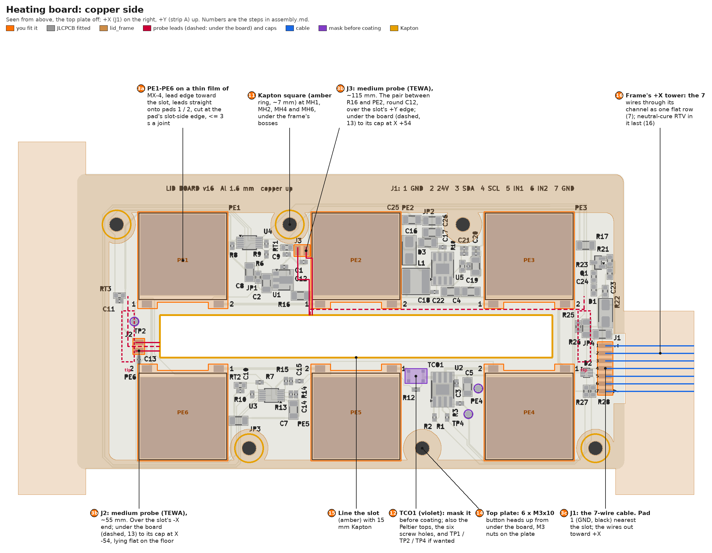
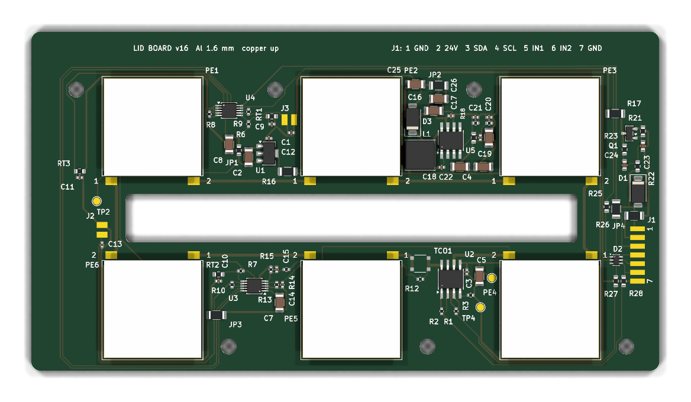

# Heating board: hand assembly and checks

The heating board is the lid's aluminium board; its silkscreen says "LID BOARD v16", and it is the same board. It is
1.6 mm aluminium, 129.5 x 70 mm, with one copper layer. It carries:
- six Peltiers in series on one DRV8871 (U2), behind TCO1, a 72 °C thermal cutoff;
- three board NTCs (RT1-RT3) and two medium probes (J2, J3), read by two ADS1115 (U3, U4);
- its own 9.16 V buck (U5) and 3.3 V LDO (U1).

JLCPCB fit every SMT part ([`jlc/ORDER.md`](jlc/ORDER.md)). You fit the six Peltiers, the two probes and the 7-wire
cable, then test, paint, frame, coat and close the lid with the top plate ([`../plate_pcb/jlc/ORDER.md`](../plate_pcb/jlc/ORDER.md)).

- **Printing `lid_frame` and the lid as a whole:** the repo README,
  ["Peltier-heated lid"](../../../README.md#peltier-heated-lid).
- **The main board,** which the lid plugs into at J20:
  [`../../frame/main_pcb/assembly.md`](../../frame/main_pcb/assembly.md). It must be built, checked and running the
  firmware before step 9.

**Order:** every hot-plate job comes first (steps 2-3). The frame's resin softens from ~77 °C, and the hot plate
would mar the paint. Then the tests, the paint, the frame, the coat, the probe leads, the plate and the slot's lining.

**The copper side,** seen from above with the top plate off: +X (J1) on the right, +Y (strip A) up. It shows the
frame's footprint, the probe and cable routes, the masks and the step numbers:

As JLCPCB build it (KiCad's 3D view, in its default green; the real mask is white):

## Conventions

- **Board frame (mm):**
  - X runs along the slot from its centre, + towards J1 (the cable end). Y is + towards strip A (PE1-PE3).
  - In KiCad, x = 150 + X and y = 100 - Y.
  - The board spans X -66..63.5 and Y -31.5..38.5. The slot spans X -46.5..46.5 and Y -5..5.
- **Meter modes:**
  - **R:** resistance; the red probe on the first point named.
  - **D:** diode test; red (+) on the first point named. A silicon junction reads 0.5-0.75 V; "OL" is open.
  - **V:** DC volts, the black probe clipped to GND.
  - **"Climbs":** the reading rises while the meter charges a capacitor. That's normal; a short reads low and stays
    there.
- **GND:** J1 pad 1 or 7, or TP4.
- **Positions** of everything named below: "Where things are", at the end.

## What you need

**Tools:**
- An iron of 60 W or more, with a 2.4-3.2 mm chisel tip.
- Leaded flux-cored solder, 0.5-0.7 mm (63/37 or 60/40), and a no-clean flux pen or gel.
- Wick, isopropanol (99 %) and a brush.
- Tweezers, flush cutters, a stripper for 26-28 AWG, a sharp blade (for the PTFE leads), heat-shrink, a craft knife.
- A hot plate, dedicated to this, that holds ~100 °C.
- A multimeter (continuity, diode test, a 200 Ω range, DC volts, mA) with sharp probes and one clip lead.
- A current-limited bench supply, 0-30 V and at least 1 A.
- A magnifier, and a straightedge.

**Parts and materials** (all in the repo's [`bom.xlsx`](../../../bom.xlsx)):

| Step | What | Part |
|---|---|---|
| 3a | PE1-PE6 | 6 x TES1-4902, 20 x 20 x 4 mm (all six from one supplier); ARCTIC MX-4 paste |
| 3b | J2, J3: the medium probes | 2 x TEWA TT4-G10KC3-T180-C312-200 (10k 1 %, B 3977, a Ø3 x 12 mm stainless cap, 200 mm AWG28 PTFE leads) |
| 3c, 8 | the 7-wire cable | 26 AWG silicone wire (~500 mm per conductor); a JST PHR-7 housing; 4 x JST ASPHSPH24K305 pre-crimped leads, cut in half (seven halves used); heat-shrink |
| 7 | the frame's coupling | as in the README: 3 x Ø8 x 3 N42 magnets, 6 x Ø2 x 10 dowels |
| 10 | paint for the aluminium side | Rust-Oleum Painter's Touch, matt black (or RS PRO 764-3039); 600-grit or a fine pad; masking tape and paper |
| 11 | the frame | the printed [`lid_frame`](../parts/lid_frame.step); two-part epoxy (Araldite Standard); Kapton tape |
| 12 | conformal coat | the BOM's conformal coating; Kapton for the masks |
| 14 | the top plate | MX-4; 6 x M3x10 button heads (ISO 7380); 6 x M3 nuts (ISO 4032 / DIN 934) |
| 15 | the slot's lining | Kapton, 15 mm wide |
| 16 | strain relief | Bostik S41 neutral-cure silicone |

## Rules for every step

1. **Inspect each joint after soldering:** bridges, dull or cold joints, lifted pads. Clean off the flux with
   isopropanol before measuring: flux reads as tens of kΩ, on the NTC inputs and the I2C lines especially.
2. **Unpowered checks before every first power-up.** If one fails, stop and find out why before going on.
3. **Powering up:**
   - set the supply's voltage and current limit with its output off, then switch it on and watch the current;
   - stop if it passes the step's stop value or sits in current limit for more than about a second.
4. **Probing a live board:**
   - clip the black lead to GND and move only the red probe;
   - use test points and connector pads, never IC pins: a slipping probe on fine pitch can put 24 V into logic;
   - keep one hand off the board.
5. **U2 and U5 are PowerPAD ICs fitted by JLCPCB:** an iron can't rework them. If a check points at one:
   - stop and photograph it;
   - check its neighbours and the netlist (`heating.kicad_sch`) before blaming the part;
   - don't heat it.
6. **The lid may be plugged into J20 live,** best with SW10 (LID HEAT) off.

## 1. On arrival

**Look:** D1 and D3's cathode bands, D2, Q1, pin 1 of U1-U5, L1, TCO1 present. Check the board is flat.

**Measure (unpowered):**
- `VB` is C26's VBUCK pad, the buck's input after the soft start Q1 and R17 (1 Ω).
- The string's two ends are PE5 pad 1 (through TCO1 to PELT+, U2 OUT2) and PE4 pad 2 (PELT-, U2 OUT1).

| # | Mode | Red | Black | Expect | What it shows |
|---|---|---|---|---|---|
| 1 | R | J1 pad 2 (+24 V) | GND | > 100 kΩ, climbs | no 24 V short (D1, Q1, the soft start's divider) |
| 2 | D | `VB` | J1 pad 2 | 0.5-0.75 V | Q1 (the soft start) and R17 in place: Q1's body diode |
| 3 | R | TP1 `9V` | GND | 14.5-15.3 kΩ | R18 + R19 = 15 kΩ; no 9 V short |
| 4 | R | TP2 `3V3` | GND | 6.5-7.5 kΩ at 20-25 °C | the three board NTC dividers (10k + RT1-RT3 each); no 3.3 V short |
| 5 | R | J1 pads 5, 6 | GND | ~50 kΩ | R1 / R2 (100k) in parallel with the DRV8871's own pull-downs |
| 6 | R | PE5 pad 1; PE4 pad 2 | GND | 110 kΩ each | the PELT+ / PELT- monitor dividers (100k + 10k) |
| 7 | D | GND | J1 pad 2 | 0.6-0.8 V | D1 the right way round (cathode on 24 V) |
| 8 | D | GND | J1 pads 3, 4, 5, 6 | 0.5-0.8 V each | D2 (the ESD array) present |
| 9 | D | GND | PE5 pad 1; PE4 pad 2 | 0.4-0.7 V | U2's low-side body diodes: its OUT and GND joints |
| 10 | D | PE5 pad 1; PE4 pad 2 | TP1 `9V` | 0.4-0.7 V | its high-side body diodes: the VM joint |
| 11 | R | J1 pad 1 | J1 pad 7 | 0 Ω | both cable grounds |
| 12 | R | TCO1's +X pad (PELT+) | PE5 pad 1 | < 0.1 Ω (zero the leads first) | TCO1 closed |

- **TCO1** opens in reflow and recloses once cool. If check 12 reads open, leave the board at room temperature for
  8 h and measure again.
- Checks 6, 9 and 10 at PE5 pad 1 also need TCO1 closed.

## A. On the hot plate

### 2. Measure the parts first

Once a part is pasted, soldered, coated and clamped, a bad one means undoing all of that.

- **Each Peltier:**
  - **R across its leads,** for a dead module. The six run in series, so one open stops the whole lid.
    - A meter reads a Peltier poorly: a fraction of a kelvin across it makes a few mV, as much as the meter's own
      test voltage. Let it lie untouched for a minute, read it both ways round, and average.
    - ~2.3 Ω is right (2.0-2.6); open or ~0 Ω is a reject.
  - **Its thickness:** 4.0 mm, all six within ~0.1 mm. The plate has to bear on every one: a thinner module is left
    with an air gap under the plate, and nothing later shows it.
    - If they're all under ~3.7 mm, stop: the frame's screw bosses would take the clamp instead of the Peltiers.
  - **The warm-finger check,** for a module built mirror-image, which would pump against the others (step 9 only finds
    the overall sign):
    - lay the module on something metal (the cold board will do), its lead edge towards you;
    - put a fingertip on its top face, and the meter on mV from the left lead (COM) to the right one;
    - all six should give the same sign, whichever face is up. Swap any that doesn't.
- **Each probe:** R across its leads, 10-12.5 kΩ at 25-20 °C.

### 3. One hot-plate session: Peltiers, probes, the cable's lid end

- Paste and place the six Peltiers first, with the board still cold (3a).
- Then put the board aluminium side down on the hot plate at ~100 °C, and let it soak a few minutes.
  - TCO1 opens at this temperature (it trips at 72 ± 5 °C). It recloses once the board is below ~57 °C, unpowered
    (step 5 checks it).
- Use the chisel tip, flux and short joints. Keep the printed frame well away from the hot plate.

**3a. PE1-PE6.** Strip A holds PE1, PE2, PE3 from -X; strip B holds PE6, PE5, PE4 from -X.
- **Which face down:** the ceramic the leads come off, so they leave at board level, clear of the top plate. On most
  modules that's label up. All six go the same way.
- **Paste, with the board cold:** a thin, even film of MX-4 on the module's down face, almost see-through. Take it to
  three edges, but stop ~2 mm short of the lead edge.
  - That edge overhangs the copper by 0.8 mm, and the lead pads are only 1.15 mm past the copper: paste there just
    squeezes out onto them.
- **Place it** with its lead edge towards the slot, squared on its copper: a ~0.2 mm rim of copper shows on the other
  three sides. Press it down with a small twist to wet the paste out. Wipe any paste off the lead pads with a dry bud.
- **The leads go straight onto the pads at their own corners, never crossed.**
  - Facing the lead edge, the left lead goes to pad 1 and the right one to pad 2, on both strips: strip B's
    footprints are turned 180° like its modules.
  - That alone sets each module's direction in the string. Turning a module over swaps both its faces and its lead
    corners, and the two cancel.
  - So the same lead colour normally lands on pad 1 of all six. If one differs but step 2's warm-finger check gave it
    the same sign, only its colours differ: leave it.
- **Then heat the board** (above), and solder each lead:
  - lay it on its pad, and cut it so its tip ends at the pad's slot-side edge (Y ±6.85). That is ~3 mm from the
    module, with the last ~1.5 mm bared and tinned. Nothing past the pad: J3's lead pair crosses that strip beside
    PE2;
  - flux, a loaded chisel tip, ≤ 3 s per joint, the iron off the module. Its internal joints are low-melt, and the hot
    plate already has it near 100 °C;
  - hold the module down with a stick for its first joint: the paste is runny when hot;
  - PE5's pad 1 is 2.4 mm from TCO1: use little flux there, and none in TCO1 (it isn't sealed).

**3b. The probes, J2 and J3** (red in the picture):
- **Where they end up:**
  - each stainless cap lies flat on the dish floor just past the coverslips' outer end, along Y, its tip towards -Y
    (away from you);
  - J2's cap is at X ~-54 and J3's at X ~+54, both under the board;
  - only the cap is in the medium.
- **The routes:**
  - each pair runs from its pads over the slot's edge, down through the slot and along the board's underside, then
    down to its cap;
  - J2's crosses the slot's -X end;
  - J3's runs from its pads between R16 and PE2 (round C12) to the slot's +Y edge at X ~-11, then under the board,
    beside the slot, to the +X end.
- **Cut the leads** to ~55 mm (J2) and ~115 mm (J3), measured from the cap. Those are the route's 46-48 and
  107-109 mm plus some leeway.
- **Strip** ~2 mm with a sharp blade or a mechanical stripper (PTFE doesn't melt back), and tin.
- **Either lead on either pad:** an NTC has no polarity. Pad 1 is the signal, pad 2 GND.
- **Solder each pair** with the board on the hot plate:
  - J3's pair lies on the copper side in its route (through the R16 / PE2 gap, round C12) to the slot's edge;
  - the rest of each lead lies on the copper side for now. It goes through the slot after the board cools (step 4).

**3c. The cable's lid end:**
- **Seven 26 AWG silicone wires, ~500 mm long.** Step 8 trims them, so cut long.
- **Colours:** the two GNDs can share black; they are the same net.

  | J1 pad | Signal | Colour, e.g. |
  |---|---|---|
  | 1 | GND | black |
  | 2 | +24 V | red |
  | 3 | SDA | yellow |
  | 4 | SCL | green |
  | 5 | IN1 | blue |
  | 6 | IN2 | white |
  | 7 | GND | black |
- **Twist** +24 V (2) with GND (1), SDA (3) with SCL (4), and IN1 (5) with IN2 (6). GND (7) runs alongside.
- **Leave the first ~35 mm at the lid end untwisted:** they pass through the frame's +X tower as one flat row.
- **Strip ~2 mm and tin.** Lay each wire on its pad and solder it:
  - pad 1 (Y -2.2) is nearest the slot, then the pads run every 1.8 mm to pad 7 (Y -13.0), all at X 59.0;
  - the wires leave towards +X, flat, in pad order.

### 4. Cool and clean

- Let the board cool on a flat, heat-proof surface.
- Clean every hand joint with isopropanol and a brush.
  - At the Peltier joints, use a damp brush, not a flood: isopropanol thins the paste and wicks under the modules.
- Pass each probe's free lead down through the slot (J2's at the -X end, J3's at X ~-11). They hang under the board
  until step 10.

### 5. Unpowered checks

- **At the cable's free ends:**
  - wire 2 to GND > 100 kΩ, climbing;
  - wires 1 and 7 to TP4: 0 Ω;
  - wires 5 and 6 to GND ~50 kΩ;
  - no wire reads 0 Ω to its neighbour.
- **TCO1 closed again:** step 1's check 12, < 0.1 Ω, once the board is below ~57 °C. If it's open, wait (up to 8 h).
- **The Peltiers:**
  - PE5 pad 1 to PE4 pad 2 (the whole string): 12-15 Ω (13.7 nominal);
  - each module across its own pads: ~2.3 Ω;
  - PE5 pad 1 to GND: now ~55 kΩ (the two 110k dividers, joined by the string).
- **The probes:** TP2 `3V3` to GND ~4.0-4.5 kΩ at 25-20 °C (five dividers: RT1-RT3 and the two probes).

### 6. The board alone, powered

- **No test plug needed:**
  - the bench supply's red lead to wire 2;
  - its black lead to wires 1 and 7, twisted together;
  - tape over the other wires' ends.
- **24.0 V, limit 100 mA.** Clip the meter's black lead to the supply's black lead.

| Check | Expect | What it shows |
|---|---|---|
| current | 4-10 mA (stop above 30 mA) | U5 idling, the LDO, the dividers |
| `VB` (C26's VBUCK pad) | 23.9-24.0 V | the soft start (Q1) on, R17 |
| TP1 `9V` | 8.93-9.39 V | U5 and R18 / R19 |
| `VL` (C1's VLDO pad), optional | ~7.8-8.6 V | 9.16 V less R16's drop |
| TP2 `3V3` | 3.20-3.40 V | U1 (HT7533-1) |
| pad 1 of RT1-RT3 (0603: careful), or wait for step 9's readings | 1.5-1.8 V at 20-30 °C (1.65 V at 25 °C) | the NTC dividers |
| PE5 pad 1, PE4 pad 2 | ~0 V | the bridge asleep (coasting). The firmware doesn't read the PELT+ / PELT- monitors yet, so this is their only check |

Nothing should get warm.

## B. The frame onto the cable, and the board's tests

### 7. Prepare the frame, and thread the cable through it

- **The frame's coupling:** epoxy one Ø8 x 3 magnet into each of its three pockets, then each pocket's dowel pair, as
  in the [README](../../../README.md#peltier-heated-lid).
  - Clean the metal with isopropanol first.
  - Keep glue off the dowels' inner flanks: they are the contact faces.
  - Polarity doesn't matter: each magnet pulls a steel ball.
- **Thread the cable:**
  - pass the seven free ends from inside the frame through the +X tower's channel and out of its +X end;
  - they go through as one flat row, in pad order (blue in the picture);
  - slide the frame up the cable, away from the board. It stays loose until step 11.
- **Why now:** the channel is closed, so the frame must be on the cable before its main-board end is made.

### 8. The main-board end: the PHR-7

- **Decide the length.** Hold the frame, with the board under it, on the lid's coupling on the unit, and run the cable
  from the tower's exit to J20, dressed as it will stay:
  - **if you'll unplug the lid at J20 to lift it** (allowed live, with SW10 off), ~30 mm of slack is enough;
  - **if it stays plugged in,** add enough to set the lid down beside the stage.
- **Cut the silicone wires** so the joints land ~100 mm short of J20, outside the main enclosure.
- **The PH halves:** cut four ASPHSPH24K305 leads in half (~150 mm each, crimped at one end).
  - They're all one colour: tag each with its pin number.
  - Trim them to ~100 mm, from the cut end.
- **Solder and heat-shrink** each joint, staggered ~10 mm apart so the bundle stays slim. Wire n goes to housing
  position n.
- **Push each crimp** into the PHR-7 until it clicks, and tug it.
- **Check, from the housing:**
  - D: red `VB`, black pin 2: 0.5-0.75 V (step 1's check 2, through wire 2);
  - R: pins 1 and 7 to TP4: 0 Ω;
  - R: pins 5 and 6 to GND: ~50 kΩ;
  - D: red GND, black pins 3 and 4: 0.5-0.8 V (D2, through the wires);
  - R: no pin reads 0 Ω to its neighbour.

### 9. On the main board

**First:**
- the main board must be built and checked, J20 included (no bridge between its pins 2 and 3: that would put 24 V on
  SDA);
- the firmware must be written: the README, "Write the firmware".

**Talking to the firmware:** over USB, in the Arduino serial monitor (newline endings) or
`screen /dev/cu.usbmodem* 115200`. The protocol is [`../../../firmware/api.md`](../../../firmware/api.md), 9.2. Or use
the app's menu, Temp calib. ([`../../../app/README.md`](../../../app/README.md)): it sets the same duty and lists the
same five temperatures.

**Plug in:** SW10 off (D11 dark). SW9 may be on or off: plugging the lid in live is allowed. The cable into J20; SW9
on.

| Command | Check | Expect | What it shows |
|---|---|---|---|
| - | 24 V current | the main board's idle current plus 4-10 mA | the lid idling |
| `status lid` | `mode` | `idle`, not `absent` | both ADS1115 answer: SDA / SCL the right way round, the lid's 3.3 V |
| `status lid` | `v33` | 3.20-3.40 V, the same as TP2 in step 6 | the NTCs' ratiometric reference (U4 AIN1) |
| `status lid` | `board.a`, `board.b`, `board.edge`, `med.j2`, `med.j3` | each within ~1-2 K of a room thermometer (the board reads ~1 K over the room, from its own buck); each `.sd` a few mK | every divider, NTC and channel. Tens of mK on a still lid means pickup or a bad joint. A probe that isn't connected reads `open` |
| SW10 on (D11 lit), `lid duty=30` for ~30 s | the `!lid` lines, once a second | `board.a` and `board.b` rise, together; the 24 V current up by ~0.08-0.12 A | the wake pulse, the PWM, U2, the string, TCO1 |
| `lid duty=-30` | `board.a`, `board.b` | they fall | the drive direction both ways |
| `lid duty=50` | 24 V current | up by ~0.14 A (3.4 W) | the firmware's cap, `lid.duty_max` |
| SW10 off while it drives | `!lid` | `sw=off`, and the current drops at once; on again, it comes back | SW10 holds the heater off |
| `lid off` | | `duty=0` | |

- **The heating sign:** + must heat. If `board.a` and `board.b` fall under `lid duty=30`, put `lid.sign: -1` in
  `/parameters.yaml` on the Teensy's SD card ([`../../../firmware/parameters.md`](../../../firmware/parameters.md)),
  restart, and check again.
- **One odd module:** if `board.a` and `board.b` move differently under a duty, suspect a module fitted mirror-image
  or with crossed leads (step 3a).
- **Full drive:** the hardware's ceiling (6.1-7.0 W at 100 %) can't be driven from the firmware, which caps the duty
  at `lid.duty_max` (50 % by default, 80 % at most). The 50 % reading stands in for it.
- **The medium's limit** (optional): dip a probe in water above 40 °C while a duty runs. The duty is cut
  (`cut=medium`), and `lid duty=10` is refused (`err medium ...`).
- **Hot-plugging** (optional, once): with SW9 on and SW10 off, unplug the cable. `!lid ... mode=absent` comes at once,
  and the Teensy and D8 don't flicker. Plug it back in: `mode=idle` within a second or two.
- **The temperatures are uncalibrated** (~±0.5 K). The probes also read a fraction of (board - medium) too warm, from
  the heat their leads bring down. Both are taken out by calibration in place, in the medium, at commissioning
  ([`../../../firmware/api.md`](../../../firmware/api.md), 9.2).

## C. Paint, frame, coat, probes, plate

### 10. Paint the aluminium side matt black

- **Why:** radiation carries about two-thirds of the board's heat to the medium. Painted (ε ~0.9), the board holds
  30 °C water at night at ~50 °C; bare, it would need ~83 °C.
- **Which paint:** an ordinary matt black aerosol that dries at room temperature.
  - It needn't be insulating, since the aluminium floats (the dielectric isolates it from the copper). But overspray
    onto the copper side must be harmless, so no metallic, graphite, "conductive" or "shielding" paint.
  - No heat-cure stove or engine paint (VHT, High Heat): those cure fully only at ~200 °C, which the board can't take,
    and they give off solvent when warm, over the samples.
- **Prepare:**
  - peel any protective film;
  - scuff the aluminium lightly (a fine pad, or 600-grit wet);
  - wipe it with isopropanol, let it dry, and don't touch it after.
- **Mask:**
  - pull both probes back up through the slot onto the copper side;
  - paper and tape over the whole copper side, the probes and their leads included;
  - tape over the slot from the copper side;
  - wrap the cable and the frame hanging on it.
- **Spray** 2-3 light coats from ~25 cm, an hour apart, until the finish is even, matt and opaque (~30-50 µm in all).
- **Cure** 24 h, ventilated, before the next step.
  - Before the lid first goes over live samples, give it a week, or run the finished lid empty at ~55 °C for a few
    hours in a ventilated room.

### 11. Glue the frame

The board sits in the frame's rim. Its copper side is ~0.55 mm under the frame's band and its six screw bosses; the
epoxy fills that gap round the edge.

1. **Kapton:** stick a ~7 mm square, pierced at the hole, on the copper side at MH1, MH2, MH4 and MH6 (amber rings in
   the picture). Signal tracks run under the frame's bosses there; MH3 and MH5 have nothing under them.
2. **The probes:** pass them back down through the slot, so nothing lies on the Peltiers.
3. **Epoxy:** a thin bead on the underside of the frame's band, kept off the six bosses and their holes.
4. **Place it:** slide the frame down the cable and over the board, seating the board in its rim.
5. **Hold it at its working height while it cures.** The simplest jig is the top plate itself: lay it on the
   Peltiers dry (no paste), and fit its six M3x10 screws and nuts as in step 14, snug. The board then sits under the
   band exactly as the stack will hold it. Keep epoxy off the plate.
6. **Cure** at room temperature, or up to 60 °C if the epoxy wants it (safe for TCO1).
7. **Take the plate off again.** Check (R): TCO1's +X pad to PE4 pad 2 reads 12-15 Ω, the string through TCO1.

### 12. Conformal coat the copper side

- **Clean the hand joints again** with isopropanol (not acetone near the frame). A coat over flux holds it against the
  copper.
- **Which coat:** the BOM's conformal coating, or an acrylic with a UV tracer (MG Chemicals 419D brush-on; 419E or
  HumiSeal 1B73 aerosols), which lets you check coverage under a 365 nm torch.
  - **Not a UV optical adhesive** (NOA and similar). It cures only where the lamp reaches, so whatever wicks under the
    parts stays liquid. It goes on thick and cures hard, which strains the 0402s and the joints as the aluminium warms
    and cools. And it doesn't come off for rework.
- **Mask with Kapton:**
  - **TCO1** (violet in the picture): it isn't sealed, and the coat could glue its contacts. It is the string's
    hardware cutoff;
  - **the six Peltier tops:** the plate's paste goes there;
  - **the six screw holes:** keep the coat out of them;
  - TP1, TP2 and TP4, if you'll want them later.
- **Before coating:** lay J3's pair flat in its copper-side route (the R16 / PE2 gap, round C12).
- **Coat** in two thin layers, 25-50 µm each, waiting between them as the label says:
  - cover every SMT part, J1's joints and the first few mm of its wires, J2 and J3 with the probe leads' copper-side
    runs (this also holds them in place), and all twelve Peltier joints;
  - take it up to the modules' edges but not under them.
  - Height doesn't matter: the coat is under 0.1 mm, against the 4 mm the Peltiers set.
- **Cure** it as the label says, ventilated (it's solvent-based).
- **Inspect:** under the UV torch if it has a tracer, otherwise at a low angle in good light. Touch up any gaps, then
  peel the masks.
- **Spot repairs later:** solder through it, or lift it locally with its remover on a bud, kept off the printed frame.

### 13. Dress the probe leads, and check again

- **Under the board,** each pair runs from the slot to its cap:
  - **J2:** from the slot's -X end towards -X, along the underside, to X ~-54;
  - **J3:** from the slot's +Y edge at X ~-11 along the underside beside the slot (Y ~6.4), out past the slot's +X end
    to X ~+54.
  - Lay each run flat on the paint. A strip of Kapton holds it there.
- **Form each riser** so its cap lies flat on the floor when the lid is seated:
  - the lead runs ~1.5 mm straight out of the cap, then bends up (R ~2) to the underside, where it bends again;
  - the cap's back (the lead end) faces +Y, at Y ~+6;
  - the underside is ~19 mm above the dish floor.
- **Check,** as in step 9:
  - `status lid`: `mode=idle`, five sensible temperatures, each `.sd` a few mK (steady: nothing pinched);
  - SW10 on, `lid duty=30` for ~10 s: `board.a` and `board.b` rise;
  - `lid off`.

### 14. The top plate

1. Spread a thin layer of MX-4 on each Peltier's top.
2. Lay the plate on, aluminium face down, its outline, slot and six holes over the board's.
3. **Six M3x10 button heads** go up from under the board, through the board, the frame's bosses and the plate, into
   M3 nuts on the plate.
   - Tighten them evenly, in a diagonal order, until the Peltiers are clamped tight between the board and the plate.
     The modules are ceramic, so don't let one corner run ahead.
   - Each tip ends ~0.5 mm past its nut.
4. **To take the plate off later:** remove the six screws, and slit the slot's lining (step 15) along the gap. The
   board, the Peltiers and the frame stay one unit.

### 15. Line the slot

- **Why:** this closes the cavity between the board and the plate at the slot, against condensate.
- **Where:** 15 mm Kapton (amber in the picture) round the slot: both long walls and both ends.
  - Bridge the 4 mm gap between the board and the plate.
  - Stick it to the plate's and the board's slot edges, and fold the excess onto the plate's top and the board's
    underside. It lies flat on the walls; nothing enters the slot's opening.
- **The probe leads** pass under it, where they cross the slot's edges: lay the tape over them.

### 16. Strain relief in the tower

- Use **neutral-cure** RTV (Bostik S41). Acetoxy silicone (it smells of vinegar) corrodes copper.
- Run a bead into the tower's channel round the seven wires. Cure 24 h.

### 17. Last check, and onto the stage

- Step 13's check once more.
- Seat the lid on its coupling. Plug the cable into J20: live is allowed, best with SW10 off.
- Each cap lies flat on the dish floor, just past the coverslips' outer end, tip away from you.
  - At the dish's ends, the pipette tips can reach the caps: keep them in view when driving there.

## Where things are (board frame, mm)

| Item | X, Y |
|---|---|
| J1 pads 1-7 | X 59.0; Y -2.2 (pad 1, nearest the slot), then every 1.8 mm to -13.0 (pad 7) |
| J2 pads 1 / 2 | (-51.4, -3.4) / (-51.4, -1.4) |
| J3 pads 1 / 2 | (-13.8, 20.3) / (-11.8, 20.3) |
| J3's route on the copper side | between R16 (X -14.6..-11.7, Y 9.6) and PE2's ceramic (from X -10.0), past C12 (Y 17.6), to the slot's +Y edge at X ~-11 |
| The probe caps, on the dish floor | X ~-54 (J2) and ~+54 (J3), Y -6 (tip) to +6 |
| TCO1 | (14.2, -9.4), beside U2. Its PELT+ pads are at X 15.9, its PE5 pads at X 12.5 |
| TP1 `9V` / TP2 `3V3` / TP4 GND | (29.0, -12.4) / (-52.5, 3.5) / (26.6, -18.4) |
| `VB` (C26's VBUCK pad) / `VL` (C1's VLDO pad) | (16.5, 24.6) / (-16.5, 16.4) |
| PE1 / PE2 / PE3 (strip A) | centres X -41 / 0 / 41, Y 18.8; lead pads at Y 7.65 |
| PE6 / PE5 / PE4 (strip B) | centres X -41 / 0 / 41, Y -18.8; lead pads at Y -7.65 |
| MH1 / MH2 / MH3 | (-56.7, 26.5) / (-15.7, 26.5) / (25.3, 26.5) |
| MH4 / MH5 / MH6 | (56.7, -26.5) / (15.7, -26.5) / (-25.3, -26.5) |

## Pin maps

| Part | Map |
|---|---|
| J1 (the cable) | pad 1 nearest the slot: 1 GND, 2 +24 V, 3 SDA, 4 SCL, 5 IN1, 6 IN2, 7 GND. The same order as J20 on the main board |
| J2 / J3 (the probes) | pad 1 the NTC's signal, pad 2 GND. Read as `med.j2` / `med.j3`. In the schematic J3's net is still `T_TOP` and its value "NTC top plate": it once read the top plate |
| The string | PELT+ (U2 pin 8) -> TCO1 -> PE5 pad 1; then PE5, PE6, PE1, PE2, PE3, PE4 in series, each pad 1 -> pad 2; PE4 pad 2 -> PELT- (U2 pin 6) |
| U4 (0x48, strip A) | AIN0 RT3 `board.edge`; AIN1 3.3 V `v33`; AIN2 RT1 `board.a`; AIN3 J3 `med.j3` |
| U3 (0x49, strip B) | AIN0 PELT+ / 11; AIN1 PELT- / 11; AIN2 RT2 `board.b`; AIN3 J2 `med.j2` |

## When a check fails

| Symptom | Look at |
|---|---|
| `mode=absent` with the lid plugged in | the lid's 3.3 V (TP2), SDA / SCL swapped in the PHR-7, D2 shorted, the PHR-7 not latched |
| `mode=fault` | a board NTC open or shorted, or `v33` outside 3.13-3.47 V: the divider, its joint, flux |
| One temperature reads `open` or `short` | its divider, the probe's joints, flux. A probe that read and then went open is a fault until the lid is unplugged and plugged back in |
| `lid duty=` changes nothing | SW10 (D11 should be lit), U2's joints (step 1, checks 9-10), the string (step 5), TCO1 open (step 1, check 12) |
| The current hits the limit at power-up | a short on +24 V (D1, C23), on `VB` after the soft start (C16, C17, C25, C26, U5's input) or on 9 V (C3-C6, C22, U2's VM) |

## Pitfalls

1. **Overheated Peltiers.** Their internal joints are low-melt. Use short joints, a big tip and a preheated board,
   and keep the iron off the module.
2. **A module fitted mirror-image, or with crossed leads,** pumps against the others. Step 9 finds the overall sign,
   not one odd module: do step 2's warm-finger check, and keep the leads straight onto their own pads.
3. **The PHR-7 crimped in the wrong order,** or a "JST-compatible" housing that doesn't latch. Buzz it from the
   housing (step 8).
4. **Flux on the NTC inputs or the I2C lines** reads as tens of kΩ and skews the temperatures. Clean with isopropanol.
5. **TCO1 cleaned, coated or soaked in flux.** It isn't sealed. Mask it before the coat.
6. **Acetoxy silicone** in the tower: it corrodes copper. Neutral-cure only.
7. **A probe slipping across fine pitch while powered.** Use the test points and connector pads, and clip GND.
8. **The main board's lid fuse (F2) tripped:** it holds a little less for about an hour afterwards. Switch off, wait
   ~30 s, and find the overload before switching on again.
